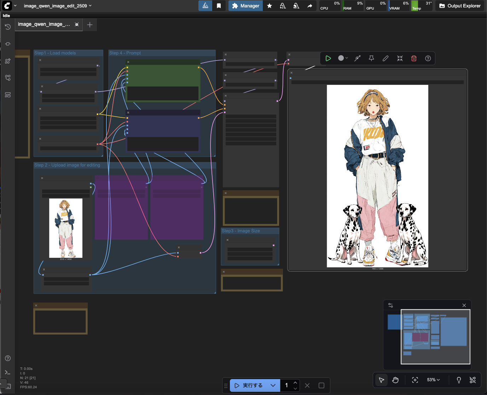

# modal-comfyui

Modal 上で ComfyUI を動かし、Hugging Face のモデルや生成素材を Modal Volume で永続管理するリポジトリです。



## 構成の選択

用途に合わせて 2 つの構成を提供しています。

| 構成 | 特徴・向いている用途 | エントリポイント | ガイド |
| --- | --- | --- | --- |
| **通常構成** | GPU 上で ComfyUI 全体を常時起動。短時間の集中作業や、既存 ComfyUI そのままの挙動・拡張性を求める場合に最適。 | `comfyapp.py` | [通常構成ガイド](docs/guides/comfyui-modal.md) |
| **CPU/GPU 分離構成 (Split)**<br>*(Experimental)* | UI・ファイル管理は CPU、生成時のみオンデマンドで GPU を起動（アイドル時は自動停止）。コストを抑えたい場合や、**MCP 連携（AI チャットからの画像生成）** を行いたい場合に最適。 | `splitapp.py` | [分離構成ガイド](docs/guides/comfyui-split.md) |

---

## クイックスタート

### 1. 環境準備

```bash
git clone https://github.com/hndrr/modal-comfyui-deploy.git
cd modal-comfyui-deploy
uv sync
cp .env.example .env
```

1. Modal CLI でログインします (`uv run modal setup`)。
2. 必要に応じて `.env` を編集します。Hugging Face のモデル保存を行う場合は、Modal Secret `huggingface-secret` を作成してください。
3. 複数アカウントを使い分ける場合は、[Modal プロファイルの固定手順](docs/operations/modal-profiles.md)を確認してください。

### 2. デプロイ

選択した構成に応じてデプロイします。

- **通常構成**:
  ```bash
  ./scripts/modal.sh serve comfyapp.py   # ローカル開発・検証
  ./scripts/modal.sh deploy comfyapp.py  # 本番デプロイ
  ```
- **CPU/GPU 分離構成 (Split app)**:
  ```bash
  ./scripts/modal.sh deploy splitapp.py
  ```

### 3. 公開とアクセス制御

安全に外部公開するために、Cloudflare Worker と Cloudflare Access を組み合わせた認証中継を推奨しています。
設定手順は [Cloudflare Access の設定](docs/operations/cloudflare-access.md) を参照してください。

> [!TIP]
> **ドキュメントのパラメータ表記について**  
> コマンド例の `<SPLIT_PUBLIC_HOST>` などの山括弧は実環境の値に置き換えます。`HOST` はホスト名のみ、`ORIGIN` はプロトコルを含む URL（例: `https://example.com`、末尾スラッシュなし）を表します。Modal の URL はデプロイ出力からコピーしてください。

---

## 主な機能とツール

### MCP（Model Context Protocol）連携
CPU/GPU 分離構成（Split app）は MCP に対応しており、ChatGPT Web、Claude Code、Codex などの AI チャットから自然言語で画像生成を指示できます。
- 利用者向け: [Split app の MCP 利用ガイド](docs/mcp/usage.md)
- 管理者向け: [MCP 設定・運用ガイド](docs/mcp/setup.md)
- ツール仕様: [MCP ツールリファレンス](docs/mcp/tools.md) / [上流ツール対応表](docs/mcp/upstream.md)

### モデルとストレージの管理
- **モデルの保存**: Hugging Face から Volume へモデルをダウンロード・永続化（[モデル保存ガイド](docs/guides/preserve-model.md)）
  - CLI: `preserve_model.py`
  - Web GUI: `preserve_model.py`
  - ローカル GUI: `preserve_model_gui.py`
- **資産管理画面**: モデル・入力・出力ファイルを Web UI から一覧・管理（[資産管理画面ガイド](docs/guides/asset-manager.md)）
- **Volume 操作ツール**: Volume の複製やファイル移動用スクリプト（[Volume 操作ガイド](docs/guides/volume-tools.md)）

---

## ドキュメント一覧

### 利用・運用ガイド
- [通常構成ガイド](docs/guides/comfyui-modal.md)
- [CPU/GPU 分離構成ガイド](docs/guides/comfyui-split.md)
- [Split app の任意拡張ノード](docs/guides/split-integrations.md)
- [既知の不具合と注意点](docs/guides/known-issues.md)
- [Cloudflare Access の設定](docs/operations/cloudflare-access.md)
- [Modal プロファイルの運用](docs/operations/modal-profiles.md)
- [テスト・CI ガイド](tests/README.md)

### 設計・検証記録
<details>
<summary>設計の経緯やアーキテクチャの検証記録を展開</summary>

| ドキュメント | 内容 |
| --- | --- |
| [MCP の経路図](docs/design/split-mcp-routing.md) | 操作ごとの実行先と CPU・GPU を起動する条件 |
| [メディア配信](docs/design/split-media-delivery.md) | 現在の参照用 CPU と、未実装の R2 配信案 |
| [split のストレージ](docs/design/split-storage.md) | 保存先の役割と当時の一度限りの移行方針 |
| [split の実行環境とストレージ](docs/design/runtime-and-storage.md) | Volume とイメージの使い分け |
| [Access と Worker](docs/design/cloudflare-access.md) | 認証・WebSocket 中継・迂回経路の遮断 |
| [CPU Memory Snapshots](docs/design/cpu-memory-snapshot.md) | split への組み込みと独立検証の記録 |
| [アイドル停止計画](docs/design/modal-idle-scale-to-zero.md) | アイドル時の縮退を導入する際の計画 |
| [Sleep/Wake 構成案](docs/design/modal-power-control.md) | 手動・自動の GPU 操作と分離構成の検討 |
| [PyTorch / CUDA の検討](docs/design/pytorch-cu130-upgrade.md) | アップグレードの調査と検証案 |

</details>

---

## ディレクトリ構成

```text
.
├── comfyapp.py                     # 通常構成の Modal アプリ（CPU/GPU 同一コンテナ）
├── splitapp.py                     # CPU/GPU 分離構成の Modal アプリ（オンデマンド GPU）
├── mediaapp.py                     # split の保存済みメディア配信専用 CPU アプリ
├── split_guis.py                   # split の /models・/assets 用 Web GUI
├── preserve_model.py               # モデル保存処理と Modal 上の Web GUI
├── preserve_model_gui.py           # ローカル環境のモデル保存 GUI
├── asset_manager.py                # Modal Volume 操作ツール
├── asset_rpc.py                    # 資産管理画面と Python バックエンド間の RPC
│
├── comfy_split/                    # split 構成のバックエンド実装
│   ├── gateway.py                  # HTTP/WebSocket 受付とリクエスト中継
│   ├── modal_proxy.py              # ASGI パス再エンコードと認証付きプロキシ
│   ├── worker.py                   # オンデマンド GPU ワーカーの実行処理
│   ├── runtime.py / startup.py     # コンテナライフサイクルと初期化画面制御
│   ├── cpu_snapshot.py             # CPU Memory Snapshot による復元
│   ├── storage.py / state.py       # Volume ストレージ・ジョブ状態台帳の管理
│   └── node_packs.py / extensions.py # ノードパック自動更新と拡張機能の配布
│
├── extensions/                     # 同梱の ComfyUI 拡張機能
│   ├── ComfyUI-Modal-Bridge/       # CPU 生成ガードとジョブ整形（split 構成に必須）
│   └── ComfyUI-Modal-Control/      # GPU 稼働状態表示とモード切替用 UI パネル
│
├── web/                            # 資産管理画面（Volume ファイルブラウザ）
│   ├── src/                        # React フロントエンド
│   └── server/                     # Hono バックエンドサーバー
│
├── worker/                         # Cloudflare Worker（認証・中継・MCP 入口）
│   ├── src/                        # Access 認証・WebSocket 中継・MCP ハンドラー
│   ├── tests/                      # Worker の自動テストスイート
│   └── wrangler.jsonc              # Cloudflare Worker 設定ファイル
│
├── mcp/                            # MCP（Model Context Protocol）連携パッケージ
│   ├── remote-call.mjs             # MCP リモート呼び出しスクリプト
│   ├── upload.mjs                  # 非対話環境向け素材アップロードヘルパー
│   └── surface.json                # 上流ツール対応定義
│
├── scripts/                        # 運用・検証・ユーティリティスクリプト
│   ├── modal.sh                    # プロファイル切り替え対応の Modal CLI ラッパー
│   ├── test_standalone.py          # Python 単体テスト共通ランナー
│   ├── prepare_models.py           # モデル一括ダウンロードスクリプト
│   ├── move_volume_file.py         # Volume 間ファイル移動スクリプト
│   └── verify_*.py                 # コンテナ内 API・アイドル・Bridge スモークテスト
│
├── docs/                           # 各種ドキュメント
│   ├── guides/                     # 各構成・機能の利用ガイド
│   ├── operations/                 # Cloudflare Access・Modal プロファイル運用
│   ├── mcp/                        # MCP 利用・設定・ツール仕様
│   └── design/                     # アーキテクチャ設計資料・技術検証記録
│
└── tests/                          # Python テストスイート
    ├── standard/                   # 通常構成の回帰テスト
    ├── split/                      # 分離構成（Gateway/Worker/Snapshot等）のテスト
    ├── assets/                     # 資産管理・RPC のテスト
    └── models/                     # モデル準備・保存処理のテスト
```

---

## ライセンス

本リポジトリで利用する主な依存ソフトウェアと、そのライセンス・出典を以下にまとめています。

<details>
<summary>主な依存ソフトウェアのライセンス</summary>

版や導入条件は、通常構成・Split app のイメージ定義と各パッケージのロックファイルに基づきます。版を固定していない依存先は、実際に導入する版のライセンスも確認してください。

| 依存先 | 確認した版 | ライセンス・出典 |
| --- | --- | --- |
| [ComfyUI](https://github.com/Comfy-Org/ComfyUI) | v0.43.0（Split app の固定コミット） | [GNU GPL v3](https://github.com/Comfy-Org/ComfyUI/blob/426f5eea52a7ece1dd599fff4cb6cd1f352ddd24/LICENSE) |
| [ComfyUI frontend](https://github.com/Comfy-Org/ComfyUI_frontend) | 1.57.4 | [GNU GPL v3](https://github.com/Comfy-Org/ComfyUI_frontend/blob/v1.57.4/LICENSE) |
| [ComfyUI-Manager](https://github.com/Comfy-Org/ComfyUI-Manager) | 4.2.2 | [GPL-3.0-only](https://pypi.org/project/comfyui-manager/4.2.2/) |
| [comfy-cli](https://github.com/Comfy-Org/comfy-cli) | 1.7.3 | [GPL-3.0-only](https://pypi.org/project/comfy-cli/1.7.3/) |
| [comfyui-mcp](https://github.com/artokun/comfyui-mcp) | 0.52.206 | [MIT](https://github.com/artokun/comfyui-mcp/blob/c64a8ec76f3345446f0f472152afcd95af846a37/LICENSE) |
| [Modal SDK](https://github.com/modal-labs/modal-client) | 1.1.4 | [Apache-2.0](https://pypi.org/project/modal/1.1.4/) |
| [Gradio](https://github.com/gradio-app/gradio) | 5.47.2 | [Apache-2.0](https://pypi.org/project/gradio/5.47.2/) |
| [Pillow](https://github.com/python-pillow/Pillow) | 11.3.0 | [MIT-CMU](https://pypi.org/project/pillow/11.3.0/) |
| [python-dotenv](https://github.com/theskumar/python-dotenv) | 1.2.2 | [BSD-3-Clause](https://pypi.org/project/python-dotenv/1.2.2/) |
| [aiohttp](https://github.com/aio-libs/aiohttp) | 3.12.15 | [Apache-2.0 AND MIT](https://pypi.org/project/aiohttp/3.12.15/) |
| [Hugging Face Hub](https://github.com/huggingface/huggingface_hub) | Split app は 0.35.1、モデル保存用イメージは版固定なし | [Apache-2.0](https://github.com/huggingface/huggingface_hub/blob/v0.35.1/LICENSE) |
| [hf_transfer](https://github.com/huggingface/hf_transfer) | モデル保存用イメージで導入（版固定なし） | [Apache-2.0](https://github.com/huggingface/hf_transfer/blob/v0.1.9/LICENSE) |

#### GPU・推論ライブラリ

| 依存先 | 版・導入指定 | ライセンス・出典 |
| --- | --- | --- |
| [PyTorch](https://github.com/pytorch/pytorch) | 2.10.0+cu130 | [BSD-3-Clause](https://github.com/pytorch/pytorch/blob/v2.10.0/LICENSE) |
| [TorchVision](https://github.com/pytorch/vision) | 0.25.0+cu130 | [BSD-3-Clause](https://github.com/pytorch/vision/blob/v0.25.0/LICENSE) |
| [TorchAudio](https://github.com/pytorch/audio) | 2.10.0+cu130 | [BSD-2-Clause](https://github.com/pytorch/audio/blob/v2.10.0/LICENSE) |
| [xFormers](https://github.com/facebookresearch/xformers) | 0.0.34 | [BSD-3-Clause ほか（同梱コードの条件を含む）](https://github.com/facebookresearch/xformers/blob/v0.0.34/LICENSE) |
| [FlashAttention](https://github.com/Dao-AILab/flash-attention)（[wheel 配布元](https://github.com/mjun0812/flash-attention-prebuild-wheels)） | 2.8.3（wheel 配布元の v0.9.0 リリース） | [BSD-3-Clause（本体）](https://github.com/Dao-AILab/flash-attention/blob/v2.8.3/LICENSE)、[BSD-3-Clause（wheel ビルド）](https://github.com/mjun0812/flash-attention-prebuild-wheels/blob/v0.9.0/LICENSE) |
| [SageAttention](https://github.com/woct0rdho/SageAttention)（ビルド元 fork） | `abi3_stable` ブランチ | [Apache-2.0](https://github.com/woct0rdho/SageAttention/blob/abi3_stable/LICENSE) |
| [comfy-kitchen](https://github.com/Comfy-Org/comfy-kitchen) | 0.2.40（Split app の ComfyUI 固定版の依存） | [Apache-2.0](https://github.com/Comfy-Org/comfy-kitchen/blob/v0.2.40/LICENSE) |
| [comfy-aimdo](https://github.com/Comfy-Org/comfy-aimdo) | 0.6.0（Split app の ComfyUI 固定版の依存） | [GNU GPL v3](https://github.com/Comfy-Org/comfy-aimdo/blob/v0.6.0/LICENSE) |

#### 通常構成で追加する Python ライブラリ

| 依存先 | 版・導入指定 | ライセンス・出典 |
| --- | --- | --- |
| [Diffusers](https://github.com/huggingface/diffusers) | 0.32.0 | [Apache-2.0](https://github.com/huggingface/diffusers/blob/v0.32.0/LICENSE) |
| [MoviePy](https://github.com/Zulko/moviepy) | 1.0.3 | [MIT](https://github.com/Zulko/moviepy/blob/v1.0.3/LICENCE.txt) |
| [librosa](https://github.com/librosa/librosa) | 0.10.2.post1 | [ISC](https://github.com/librosa/librosa/blob/0.10.2.post1/LICENSE.md) |
| [SoundFile](https://github.com/bastibe/python-soundfile) | 0.12.1 | [BSD-3-Clause](https://github.com/bastibe/python-soundfile/blob/0.12.1/LICENSE) |
| [ftfy](https://github.com/rspeer/python-ftfy) | 6.2.3 | [Apache-2.0](https://github.com/rspeer/python-ftfy/blob/v6.2.3/LICENSE.txt) |
| [Matplotlib](https://github.com/matplotlib/matplotlib) | 版固定なし | [Matplotlib License](https://github.com/matplotlib/matplotlib/blob/main/LICENSE/LICENSE) |
| [ONNX Runtime](https://github.com/microsoft/onnxruntime)（`onnxruntime-gpu`） | 版固定なし | [MIT](https://github.com/microsoft/onnxruntime/blob/main/LICENSE) |
| [scikit-image](https://github.com/scikit-image/scikit-image) | 版固定なし | [BSD-3-Clause ほか（ファイル別の条件を含む）](https://github.com/scikit-image/scikit-image/blob/main/LICENSE.txt) |
| [Accelerate](https://github.com/huggingface/accelerate) | 1.1.0 | [Apache-2.0](https://github.com/huggingface/accelerate/blob/v1.1.0/LICENSE) |
| [GGUF Python](https://github.com/ggml-org/llama.cpp/tree/master/gguf-py) | 版固定なし | [MIT](https://github.com/ggml-org/llama.cpp/blob/master/LICENSE) |
| [Taichi](https://github.com/taichi-dev/taichi) | `>=1.6,<1.8` | [Apache-2.0](https://github.com/taichi-dev/taichi/blob/v1.7.4/LICENSE) |

#### Web・MCP の実行時ライブラリ

| 依存先 | 確認した版 | ライセンス・出典 |
| --- | --- | --- |
| [MCP TypeScript SDK](https://github.com/modelcontextprotocol/typescript-sdk) | Worker は 1.32.1、MCP は 1.32.2 | [MIT](https://github.com/modelcontextprotocol/typescript-sdk/blob/3b73021a0a2272c0c04c3917bcdb03398b3ec63f/LICENSE) |
| [jose](https://github.com/panva/jose) | 6.2.8 | [MIT](https://github.com/panva/jose/blob/v6.2.8/LICENSE.md) |
| [Zod](https://github.com/colinhacks/zod) | 4.6.7 | [MIT](https://github.com/colinhacks/zod/blob/v4.6.7/LICENSE) |
| [Hono](https://github.com/honojs/hono) | 4.12.34 | [MIT](https://github.com/honojs/hono/blob/v4.12.34/LICENSE) |
| [Hono Node Server](https://github.com/honojs/node-server) | 1.19.17 | [MIT](https://github.com/honojs/node-server/blob/v1.19.17/LICENSE) |
| [Busboy](https://github.com/mscdex/busboy) | 1.6.0 | [MIT](https://github.com/mscdex/busboy/blob/v1.6.0/LICENSE) |
| [React / React DOM](https://github.com/facebook/react) | 19.2.8 | [MIT](https://github.com/facebook/react/blob/v19.2.8/LICENSE) |
| [React Aria Components](https://github.com/adobe/react-spectrum/tree/main/packages/react-aria-components) | 1.20.0 | [Apache-2.0](https://github.com/adobe/react-spectrum/blob/react-aria-components%401.20.0/LICENSE) |

#### 実行環境

| 依存先 | 版・導入指定 | ライセンス・出典 |
| --- | --- | --- |
| [NVIDIA CUDA Toolkit](https://developer.nvidia.com/cuda-toolkit) | 13.0 系 | [NVIDIA CUDA EULA・同梱コンポーネントの条件](https://docs.nvidia.com/cuda/archive/13.0.0/eula/index.html) |
| [FFmpeg](https://github.com/FFmpeg/FFmpeg) | apt で導入（版固定なし） | [LGPL / GPL など（ビルド構成による）](https://github.com/FFmpeg/FFmpeg/blob/master/LICENSE.md) |
| [Node.js](https://github.com/nodejs/node) | Split app の MCP 実行環境は 24.22.2 | [MIT・同梱コンポーネントのライセンス](https://github.com/nodejs/node/blob/v24.22.2/LICENSE) |

#### 導入するカスタムノード

ライセンスの参照先は Split app で固定している版です。通常構成では、導入時に取得した版の条件も確認してください。

| ノードパック | 導入構成 | ライセンス・出典 |
| --- | --- | --- |
| [ComfyUI-Crystools](https://github.com/crystian/ComfyUI-Crystools) | 通常構成・Split app | [MIT](https://github.com/crystian/ComfyUI-Crystools/blob/2f18256c5b5063937106f29a8e0a7db3ae3869b7/LICENSE) |
| [ComfyUI_Local_Media_Manager](https://github.com/Firetheft/ComfyUI_Local_Media_Manager) | 通常構成・Split app | [GNU GPL v3](https://github.com/Firetheft/ComfyUI_Local_Media_Manager/blob/5e74ce0cc708798ed25a77097d6059b6c796da87/LICENSE) |
| [ComfyUI-Image-Browsing](https://github.com/hayden-cn/ComfyUI-Image-Browsing) | 通常構成・Split app | [GNU GPL v3](https://github.com/hayden-cn/ComfyUI-Image-Browsing/blob/3d0b5f8233d9d6b322ed3ff9a6cb15efbcf7bed7/LICENSE) |
| [rgthree-comfy](https://github.com/rgthree/rgthree-comfy) | 通常構成・Split app | [MIT](https://github.com/rgthree/rgthree-comfy/blob/2c5342a8cb0eaecaabf61435a5f37dd594c510ba/LICENSE) |
| [ComfyUI-MiniMax-H3-MotionCache-FastVAE](https://github.com/Mozer/ComfyUI-MiniMax-H3-MotionCache-FastVAE) | Split app | [MIT（ノードのコード）](https://github.com/Mozer/ComfyUI-MiniMax-H3-MotionCache-FastVAE/blob/b719329e0ecf35f0ae08d241c363ed1e56adbb95/LICENSE) |

</details>

この一覧は主な依存先をまとめたもので、推移的依存やビルドツールを含むすべての配布物を網羅していません。追加する任意拡張・ノード・モデルには、それぞれのライセンス・利用条件が適用されます。導入するコードやモデル、イメージを再配布する場合は、対象の版の条件と必要な著作権表示・ライセンス文書を確認してください。
