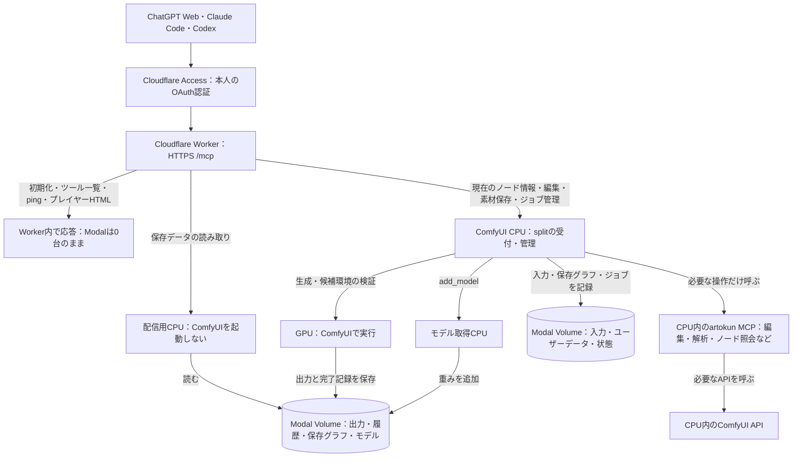
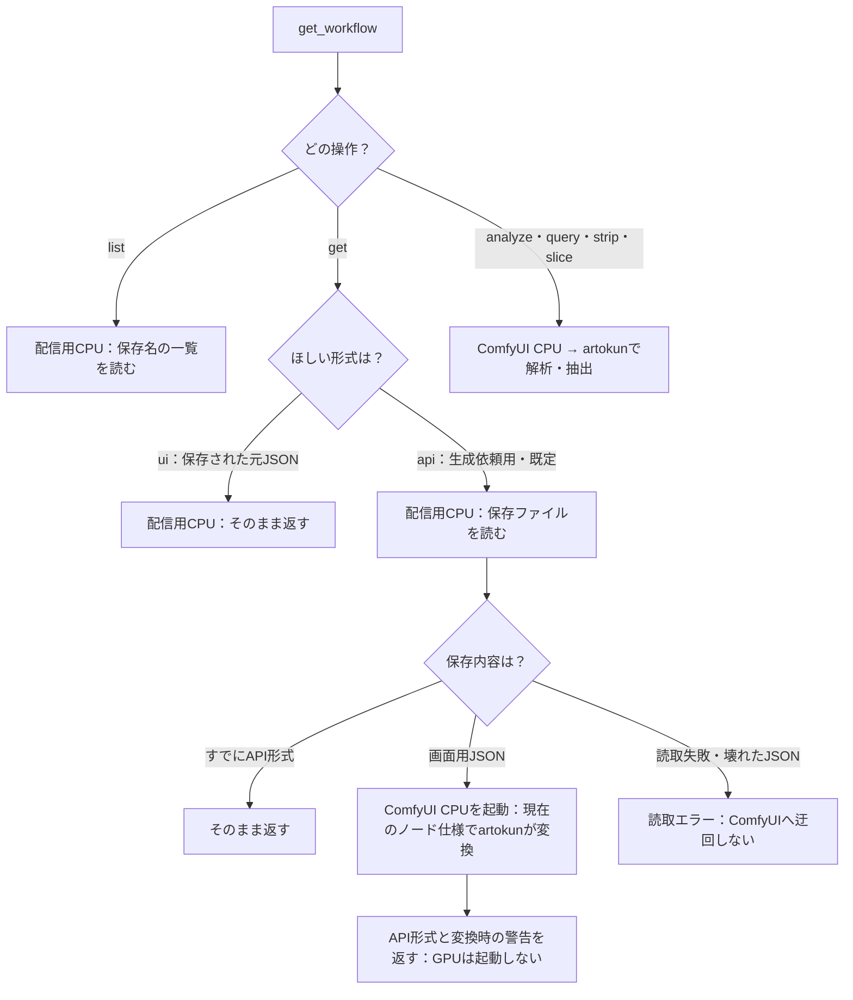
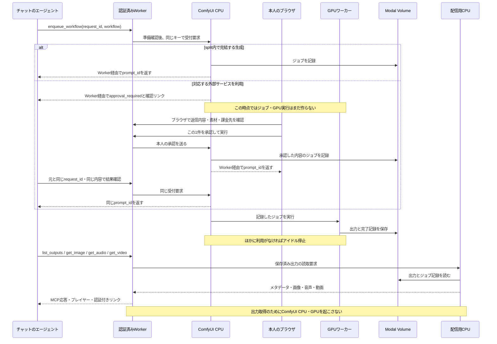
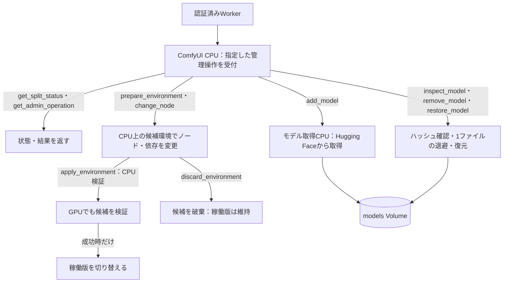

# リモート MCP の経路と、起動するCPU・GPU

この図は、リポジトリのWorker・splitと配信用CPUを構成した場合の経路です。[ツール一覧](../mcp/tools.md)で操作を選び、ここで実行先を確認できます。[設定手順](../mcp/setup.md)と[保存データの配信・R2の将来案](split-media-delivery.md)は別ページです。

## 全体の経路

クライアントはすべて同じHTTPS `/mcp` にOAuthで接続します。手元のMacでartokun MCPサーバーを起動する経路はありません。CLIの素材転送ヘルパーも同じHTTPS接続を使います。

図のVolumeは用途ごとの表記で、一部は同じ `data` Volumeです。**配信用CPU（参照用CPU）とComfyUI CPUは別コンテナ**です。配信用CPUは `output / data / models` を読み、ComfyUI・PyTorch・Node.jsを起動しません。モデルは名前・サイズなどだけを読み、重みをロードしません。

artokun版はCPU内で必要な操作に使うライブラリです。HTTPSで公開するツール一覧・認証・配信・splitのジョブ管理はこのリポジトリが担当します。artokunのリポジトリを改修する必要はありません。[上流との対応表](../mcp/upstream.md)に、直接使用・splitで代替・未提供の範囲があります。

## どの操作がどこへ行くか

| 操作 | Workerから先の経路 | 保存・生成への影響 |
| --- | --- | --- |
| 接続、ツール一覧、`ping`、プレイヤーHTML | Worker内で完結 | Modalを起こさない |
| `get_image / get_audio / get_video / list_outputs` | 配信用CPU → 出力とジョブ記録 | 読み取りだけ |
| `get_history / get_job_workflow` | 配信用CPU → ジョブ別の保存記録とGPUの完了記録 | 保存時点の情報。ライブ監視ではない |
| `get_workflow(list)`・元JSON・保存済みAPI形式 | 配信用CPU → 保存ライブラリ | 読み取りだけ |
| `list_models` の既定の保存一覧 | 配信用CPU → モデルのファイル情報 | 重みを読んで動作試験はしない |
| `get_workflow` の変換・解析、`create_workflow` | ComfyUI CPU → artokun → 必要なComfyUI API | 生成しない。編集結果は応答内のJSON |
| `save_workflow / visualize_workflow / calculate / search_custom_nodes` | ComfyUI CPU → artokun | 保存するのは `save_workflow`。計算・図示も現在はこの経路 |
| `list_models(source:runtime) / list_nodes` | ComfyUI CPU → モデル選択肢・ノード登録情報 | 読み取りだけ |
| `list_inputs / inspect_media / upload_media / reuse_output` | ComfyUI CPU → 入出力Volume | `upload_media / reuse_output` は入力を保存 |
| `queue / get_job_progress / cancel_job` | ComfyUI CPU → ジョブ台帳・実行中ジョブの制御 | 取消は指定した1件だけ |
| `enqueue_workflow` | ComfyUI CPUで受付 → GPUで実行 → Volumeへ保存 | 新しい生成。外部サービスは本人承認を挟む構成 |
| モデル・ノードの管理 | ComfyUI CPU → 操作に応じて候補環境・モデル取得CPU・GPU | 下の管理経路を参照 |

配信用CPUの設定がある場合、保存データの読み取りは `/split/startup` を呼びません。ComfyUI CPUを使う経路は準備完了を確認してから操作を実行します。起動が間に合わなければ再試行可能な「起動中」、初期化に失敗した場合は「初期化失敗」を返します。準備前に生成を投入しません。

## ワークフロー取得でComfyUIを起こす場合

画面で保存するJSONは、ノードの位置・線・ウィジェットの値を含みます。生成依頼のAPI形式は、ノードごとに入力名と値を指定します。この変換には、現在インストールされているノードの入力仕様を使います。

`format: ui` は元JSONの取得です。API形式で保存されたファイルを画面用に逆変換する指定ではありません。どの取得・変換操作も、それだけでは生成しません。生成するには別途 `enqueue_workflow` が必要です。

モデル一覧も同じように「保存ファイル」と「ComfyUIへの問い合わせ」を区別します。

| 引数 | 確認していること | 実行先 |
| --- | --- | --- |
| `list_models(source:storage)`（既定） | Volumeにどんなファイルがあるか。名前・サイズ・更新日時 | 配信用CPU |
| `list_models(source:runtime)` | ComfyUIのCheckpointやLoRAなどの選択肢に何が表示されるか | ComfyUI CPU |

どちらもモデルの破損・GPUメモリ不足・生成品質まで検証する操作ではありません。GPUは起動しません。

## 生成して、後から出力を取る経路

以下の本人承認は対応版のWorker・splitと設定を適用した構成です。OAuthログインは、外部サービスへの送信・課金を承認する操作ではありません。

外部送信を拒否した場合、期限切れ、送信先や内容を特定できない場合は生成を受付しません。料金の最終額は事前には確定しません。対応する直接APIとComfyのクレジットは課金先が異なり、確認ページに表示します。[承認の使い方](../mcp/usage.md#外部サービスを使うときの承認)を参照してください。

通信が切れた場合も、同じ `request_id`・同じ内容なら同じ `prompt_id` を返します。チャット切断・音声の再生失敗・出力の再取得を理由に、新しい生成キーを発行しません。新しいバリエーションを生成するときだけ新しいキーにします。

## 添付・プレイヤー・ブラウザの経路

| 用途 | 経路と認証 | ComfyUI CPU |
| --- | --- | --- |
| ChatGPTの添付 | ChatGPTが渡した添付情報 → Workerが許可済み配信元から取得 → ComfyUI CPUで分割検証・入力に確定 | 起動する。取得元に本人の認証ヘッダーは送らない |
| CLIのローカルファイル | 転送ヘルパーがファイルを読む → 同じOAuthのHTTPS MCP → ComfyUI CPU | 起動する。クライアント上に別のMCPサーバーは立てない |
| MCP内の音声プレイヤー | HTMLはWorker、音声部分は `read_audio_part` → 配信用CPU → output Volume | 起動しない |
| ブラウザで出力を再生・保存 | 通常のAccessブラウザログイン → Worker → 配信用CPU → output Volume | 配信対応形式の元の出力ファイルなら起動しない。GLB・SVGなどは従来のComfyUI経路 |
| 入力画像・一時画像・`preview` / `channel` 指定の画像変換 | ブラウザ認証 → Worker → 通常のComfyUI API | 起動する |

MCP用OAuthとブラウザログインは別の認証経路です。リンクを開くブラウザ側ではログインが必要になる場合があります。公開バケットや認証なしURLは使いません。PNG・音声・動画を取得できることと、クライアントがその形式のプレイヤーを表示できることは別です。

## 管理操作の経路

`apply_environment` は画像生成でなくてもGPUを起動します。ノード変更中や環境検証中は通常の生成受付を制限します。`add_model` はモデル取得用のCPUも使います。`inspect_model` は配信用CPUのサイズ一覧とは違い、ファイル全体のSHA-256を計算するため、大きいファイルでは時間がかかります。

## アイドル停止と認証の境界

- 初期化・ツール一覧・`ping`・静的リソース取得ではModalに触れません。常時監視やサーバー側keep-aliveは追加しません。
- 保存データの取得だけなら配信用CPUだけが起動し、取得終了後に停止します。ComfyUIを使う処理ではそのCPUも必要です。30秒は既存の停止待ち設定であり、復帰・停止時間の保証ではありません。
- `queue`・`get_job_progress`・`get_split_status` の連続照会はComfyUI CPUへの利用になります。0台への縮退を確認するときは、Modalの管理側で台数を見ます。常時起動モード・候補編集中・別の利用がある場合は同じ停止条件になりません。
- Workerは本人・対象アプリ用の署名済みJWTを検証し、固定した転送先だけへ接続します。Modalへ渡すのは専用のProxy Authで、本人のCookie・JWT・Authorizationは取り除きます。Modalの直接URLもProxy Auth必須です。
- 配信用CPUは保存先内の読み取りだけを受け付けます。読み取り失敗から生成・ComfyUIへの自動切替は行いません。明示的な画面用JSON→API形式の変換要求だけは上の分岐を使います。

R2は現在の経路に含みません。[将来案](split-media-delivery.md#将来案r2-に配信用コピーを置く未実装)として、原本をModalに置いたまま配信用コピーを持つかを整理しています。

## 実装との対応

| 担当 | ファイル |
| --- | --- |
| MCP登録、起動待ち、実行先の振り分け | [remote-mcp.ts](../../worker/src/remote-mcp.ts) |
| 保存ファイルのMCP呼び出し | [saved-catalog.ts](../../worker/src/saved-catalog.ts)、[saved-media.ts](../../worker/src/saved-media.ts) |
| 配信用CPUの定義、Volume読取・配信 | [mediaapp.py](../../mediaapp.py)、[saved_catalog.py](../../comfy_split/saved_catalog.py)、[media_server.py](../../comfy_split/media_server.py) |
| 上流artokunへの限定した呼び出し | [remote-call.mjs](../../mcp/remote-call.mjs)、[surface.json](../../mcp/surface.json) |
| ジョブ・素材・制作操作・管理 | [gateway.py](../../comfy_split/gateway.py)、[production.py](../../comfy_split/production.py)、[split_admin.py](../../comfy_split/split_admin.py) |
| 外部送信の確認と本人承認 | [mcp_policy.py](../../comfy_split/mcp_policy.py)、[mcp_approvals.py](../../comfy_split/mcp_approvals.py)、[job-review.ts](../../worker/src/job-review.ts) |
