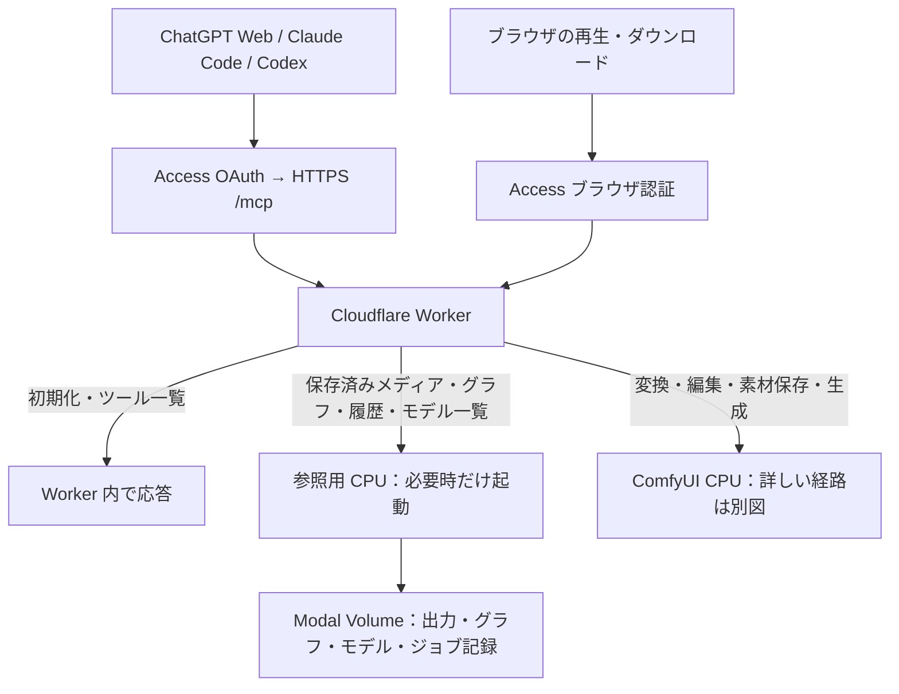

# 保存データの配信

このページはVolumeからの読み取り・配信方式を説明します。任意の外部コピーは[配信アダプタ](media-delivery-adapter-plan.md)を参照してください。MCP全体の起動分岐は[経路図](split-mcp-routing.md)、利用する操作は[ツール一覧](../mcp/tools.md)を参照してください。

## 現在の構成：原本は Modal Volume、取得は参照用 CPU

生成済みメディア・保存済みワークフローの元JSON・履歴・モデルの保存一覧は、ComfyUI を起動せずに参照する。実行用形式への変換やComfyUIのモデル選択肢の確認には、[別の経路](split-mcp-routing.md#ワークフロー取得でcomfyuiを起こす場合)を使う。
Worker が認証したリクエストを、独立した `comfy_split/mediaapp.py` の配信用 CPU に渡す。
ここでいう「アプリ」は Modal のデプロイ単位。利用者が別の画面やログイン先を使うという意味ではない。
既存の HTTPS URL を使い、ファイルも複製せず同じ Volume から読む。
このアプリは Python 標準ライブラリで出力ファイル・保存グラフ・ジョブ記録・モデルのファイル情報を読む。
ComfyUI・PyTorch・Node.js・artokun MCP を起動せず、output・data・models Volume だけを接続する。
モデルの重みはロードせずファイル情報だけを読む。入力・ノード環境の Volume は接続しない。

| 操作 | 起動するもの |
| --- | --- |
| MCP 初期化・ツール一覧・静的プレイヤー HTML | Worker のみ |
| `get_image`・`get_audio`・`get_video`・`get_3d`・`read_audio_part`・`read_video_part`・`read_3d_part`・`list_outputs` | 配信用 CPU のみ |
| `list_models` の既定の保存ファイル一覧 | 参照用 CPU のみ。ComfyUI の認識確認ではない |
| `get_workflow(list)`、`get(format:ui)`、保存済み API グラフの `get` | 参照用 CPU のみ |
| `get_history(list/diagnose)`・`get_job_workflow` | 参照用 CPU のみ。保存時点の記録 |
| `list_models(source:runtime)`、UI→API 変換、グラフ解析・検証 | 従来の split CPU。現在のノード定義を使う |
| `/view`・`/api/view` の元の output ファイル（下記の対応形式） | 配信用 CPU のみ |
| SVGなど配信未対応形式の `/view` | 従来の split CPU |
| 入力・一時プレビュー・`.split-temp` 配下、`preview` / `channel` 付き変換、ノード・ライブ進捗照会 | 従来の split CPU |
| 生成 | 従来の split CPU と GPU |

配信用 CPU は 0.25 CPU / 512 MiB、最小0台・最大1台。起動待ちは実際のファイル要求で処理し、
`/split/startup` を呼ばない。リクエスト終了後は自動縮退する。30秒は停止待ち設定であり起動・停止時間の保証ではない。
再生中の転送には CPU を使う。読み込み済みデータの再生や、クライアントが停止した後の keep-alive は追加しない。

配信対象はPNG・JPEG・WebP・GIF、MP3・WAV・FLAC・Ogg・Opus・M4A、MP4・MOV・WebM・MKV、GLB・SPZ。
Workerは拡張子で経路を選ぶ。これ以外の出力も従来のComfyUIから開ける。対応形式の配信が失敗した場合にComfyUIへ送り直す仕組みではない。

### 保存済み3Dの取得と表示

通常保存されたGLB/SPZは `list_outputs` に `kind: "3d"` として含め、`get_3d(filename, subfolder?)` で形式・MIME・サイズ・閲覧URLとビューアーを返す。MIMEはGLBが `model/gltf-binary`、SPZが `application/octet-stream`。`inspect_media` はファイル名・種類・形式・サイズだけを返し、ffprobeを使わない。3Dのアップロード・再利用や `list_inputs` の対象拡張は行わない。

GLBのPBR描画はThree.js 0.180.0、SPZ Gaussian splatの描画はSpark 2.4.0を使う。Workerビルド時に描画コード・デコーダーを同梱し、重みの取得や推論環境の設定を必要としない。MCPではアプリ専用の `read_3d_part` が最大512 KiBずつ読み、バイト列は `_meta["split/3dPart"]` だけに格納する。最初のETagを全チャンクのIf-Rangeに引き継ぎ、同サイズの差し替えも中断する。メタデータは1バイトのRange応答から取得し、各チャンクでの再プローブやヘッダーの再検査は行わない。ファイル内容は描画時に検証する。ETagが取得できない場合はブラウザ用リンクを返す。チャット内表示の上限は128 MiBで、Accessのブラウザ用URLへ直接fetchしない。ホストのCSP・WebGL等の制約やツール取得の非対応時は、ブラウザ認証付きの閲覧・保存リンクを案内する。ブラウザも128 MiBで読み込みを打ち切り、超過時は元ファイルの保存リンクを残す。

ブラウザから通常のページ遷移で `/view?type=output&filename=…&subfolder=…` を開くと、Workerが認証後に3DビューアーHTMLを返す。`/api/view` は原本バイトを返し、GET / HEAD / Rangeの意味を維持する。MCPツールの成功だけで実クライアントの描画成功とは判断しない。

一時プレビューのアーカイブ先 `.split-temp` は隠しパスのまま保ち、ブラウザの要求はComfyUI CPUへ送る。配信用CPUとMCPの保存済み3D取得・出力一覧では対象外とする。既存の一時ファイルの保持・清掃方針は変更しない。ローカルの表示確認は[テスト手順](../../tests/README.md#3dビューアーの表示確認)を参照。

### 配信と保存データの読み取り

ファイルは256 KiBずつ送り、全体をメモリに載せない。GET / HEAD、単一 Range（途中・末尾）、
ETag / If-Range に対応する。範囲外は416、削除済みは404、ストレージのI/O障害は再試行可能な503。途中でファイルが置き換わったら配信を中断し、
新旧の内容を混ぜない。保存領域の再読み込みとファイル操作は排他し、遅いクライアントへの送信中はファイルを閉じる。

新規の公開 URL、公開バケット、認証の Bypass は不要。Modal の直接 URL は Proxy Auth が必要。
Worker は固定された配信先にだけ接続し、ユーザーの JWT・Cookie・Authorization は渡さない。
保存先外へのパス、シンボリックリンク、隠しファイル、生成・削除・書き込み操作は受け付けない。
配信失敗時は再試行可能な読取エラーを返し、ComfyUI へ自動迂回しない。

モデルの既定一覧は Volume 内のディレクトリと通常ファイルを読み、サイズ・更新日時を返す。
ComfyUI が追加登録する別名カテゴリや拡張子の制約は推測しない。実際にローダーで選べるかは
`source: "runtime"` で照会する。モデルを追加・削除しても、次の保存ファイル一覧で Volume を再読み込みする。

ワークフローは `data/user/default/workflows` の日本語名・サブフォルダを扱う。
API 形式で保存されていれば直接返す。UI→API 変換は現在のノード定義を必要とするため、
保存ファイルが UI 形式の場合だけ既存 ComfyUI 経路を使う。ノード定義のキャッシュは追加しない。
取得失敗や壊れた JSON を「変換が必要」と見なして ComfyUI を起動しない。

履歴では CPU が保存したジョブ別の記録に GPU の完了記録を重ね、CPU が停止中に完了した結果も取得する。
一覧は小さな索引を順に読み、返す件数分だけ本文を取得する。失敗がCPU側で確定しGPUの完了記録がなくても取得できる。
承認待ち本文や期限切れジョブの履歴を含む台帳全体は読まない。新しい保存形式への移行は[設定手順](../mcp/setup.md#保存済みメディア配信用-cpumediaappの設定)を参照。
`live: false` を付け、実行中の最新状態と区別する。診断は指定 ID、または直近の指定件数内の
失敗を優先する。`get_job_workflow` は投入したグラフだけを返し、認証用 extra_data は返さない。

`prompt_id` で取得する操作は既存ジョブ記録の保持期間（7日）に従う。記録が期限切れでも、
通常保存された原本が残っていればファイル名によるブラウザ取得や `get_image`・`get_3d` は可能。今回、独立した永続ライブラリ索引は追加しない。

## 任意の外部配信

画像・音声・動画・GLB/SPZの配信用コピーは、任意の `MEDIA_DELIVERY` 設定で別サービスに接続する。[配信アダプタ](media-delivery-adapter-plan.md)にAPI契約と本体の動作をまとめる。保存方式・保持方針・無料枠・共有・ギャラリーの詳細は提供側リポジトリで管理する。
