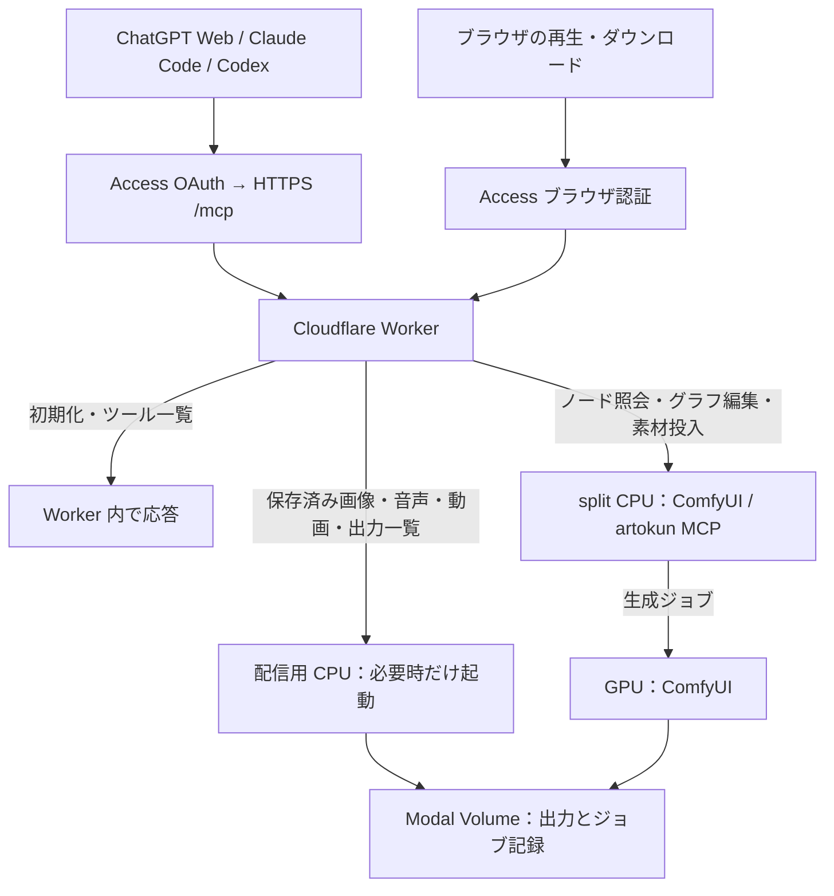

# 保存済みメディアの配信と R2 の将来案

## 現在の構成：原本は Modal Volume、取得は配信用 CPU

生成済みの画像・音声・動画を取得するために ComfyUI を起動しない。
Worker が認証したリクエストを、独立した `mediaapp.py` の配信用 CPU に渡す。
ここでいう「アプリ」は Modal のデプロイ単位。利用者が別の画面やログイン先を使うという意味ではない。
既存の HTTPS URL を使い、ファイルも複製せず同じ Volume から読む。
このアプリは Python 標準ライブラリで出力ファイルと保存済みジョブ記録を読む。
ComfyUI・PyTorch・Node.js・artokun MCP を起動せず、モデル・入力・ノード環境の Volume も接続しない。

| 操作 | 起動するもの |
| --- | --- |
| MCP 初期化・ツール一覧・静的プレイヤー HTML | Worker のみ |
| `get_image`・`get_audio`・`get_video`・`read_audio_part`・`list_outputs` | 配信用 CPU のみ |
| `/view`・`/api/view` の元の output ファイル | 配信用 CPU のみ |
| 入力・一時画像、`preview` / `channel` 付き変換、ノード・通常履歴照会 | 従来の split CPU |
| 生成 | 従来の split CPU と GPU |

配信用 CPU は 0.25 CPU / 512 MiB、最小0台・最大1台。起動待ちは実際のファイル要求で処理し、
`/split/startup` を呼ばない。リクエスト終了後は自動縮退する。30秒は停止待ち設定であり起動・停止時間の保証ではない。
再生中の転送には CPU を使う。読み込み済みデータの再生や、クライアントが停止した後の keep-alive は追加しない。

ファイルは256 KiBずつ送り、全体をメモリに載せない。GET / HEAD、単一 Range（途中・末尾）、
ETag / If-Range に対応する。範囲外は416、削除済みは404。途中でファイルが置き換わったら配信を中断し、
新旧の内容を混ぜない。保存領域の再読み込みとファイル操作は排他し、遅いクライアントへの送信中はファイルを閉じる。

新規の公開 URL、公開バケット、認証の Bypass は不要。Modal の直接 URL は Proxy Auth が必要。
Worker は固定された配信先にだけ接続し、ユーザーの JWT・Cookie・Authorization は渡さない。
保存先外へのパス、シンボリックリンク、隠しファイル、生成・削除・書き込み操作は受け付けない。
配信失敗時は再試行可能な読取エラーを返し、ComfyUI へ自動迂回しない。

`prompt_id` で取得する操作は既存ジョブ記録の保持期間（7日）に従う。記録が期限切れでも、
原本が残っていればファイル名によるブラウザ取得や `get_image` は可能。今回、独立した永続ライブラリ索引は追加しない。

## 将来案：R2 に配信用コピーを置く（未実装）

R2 を導入する動機は、繰り返しの再生・ダウンロードで Modal の配信用 CPU も起こさないこと。
モデルの重み・入力素材は引き続き Modal に置き、コピー対象は完成した画像・音声・動画に限定する。
Volume 全体を複製しない。

候補経路は `生成 → Volume commit → 別の CPU が R2 へコピー → Worker が認証して配信`。
コピーを GPU の処理完了条件にせず、生成成功と配信準備中・転送失敗を区別する。
失敗時は転送だけを再試行し、生成し直さない。ファイルサイズ・SHA-256・版を記録し、
アップロードが完了するまで利用可能として公開しない。大きな動画は multipart で送る。

採用前に決めるのは R2 の保持方針。以下は選択肢であり、今回いずれも適用しない。

| 位置付け | 保持・削除 | コピーがない場合 |
| --- | --- | --- |
| 容量を制限した配信用キャッシュ | 原本を Modal に残し、古い R2 コピーだけ整理 | 配信用 CPU から取得・再コピー |
| 独立した成果物ライブラリ | 明示的に削除するまで保持。Modal 原本の削除とは連動させない | 転送状態を表示し、必要なコピーだけ再試行 |

後者では、検索・一覧用の永続索引と、原本・R2コピーそれぞれの削除操作が必要になる。
既存 `/assets` と MCP から利用する場合も、通常の ComfyUI の `/assets/*.js` と衝突させない。
R2 は非公開のまま Worker 経由で配信する。チャット内プレイヤーの認証・CSP・Range は実クライアントで検証する。
短期URLを導入するかは別の判断であり、バケットの公開や Access の解除を前提にしない。

## 費用と採用判断

2026-11-03 時点の公開料金。無料枠は他用途との共用であり、この機能の無料動作を保証しない。

- [Modal](https://modal.com/pricing)：Volume 保存に1 TiB分の無料枠。モデルと成果物の両方で消費する。
  CPU・メモリには実行料金があり、[外向き転送](https://modal.com/docs/guide/network-egress-billing)には別の無料枠がある。
  R2 へ送るデータも外向き転送に該当する。Volume 内の読み書きとは区別する。
- [R2 Standard](https://developers.cloudflare.com/r2/pricing/)：10 GB-month、書込系100万回・読取系1,000万回まで無料。
  保存超過は $0.015/GB-month。外向き転送料は無料だが、書込・読取操作と Worker 利用は別枠。
- [Workers Free](https://developers.cloudflare.com/workers/platform/pricing/)：1日10万リクエスト、1呼出し10msのCPU時間上限。
  認証と MCP の処理も含めて測定する。動画のシークや分割取得でリクエスト数が増える。

まず配信用 CPU の起動時間・実行時間・配信量・再取得頻度を確認する。
コールドスタート待ちや繰り返し取得の負担が問題になった時点で、R2 の保持容量と費用を比較する。
R2 は動画ファイルを保存できるが、自動トランスコードや適応ビットレート配信は別機能。

## 参考にした構成

- [lynclee/comfyui_modal_bridge](https://github.com/lynclee/comfyui_modal_bridge/blob/4f35be2c60538b259c492671eef6bfe7e28fa7ea/SETUP.md#L345-L360)：
  `aigc-r2` はWebサイトへの任意の納品先。短期アップロードURLと、通知失敗後に回収できるファイル情報が参考になる。
  同じ生成処理内で転送を待つ部分や、受渡し後に原本を削除する方針はそのまま採用しない。
- [artokun/comfyui-mcp-relay](https://github.com/artokun/comfyui-mcp-relay)：ローカルの Agent Panel と MCP をつなぐ WebSocket 中継。
  今回の HTTPS MCP・ファイル配信とは役割が異なるため導入しない。
