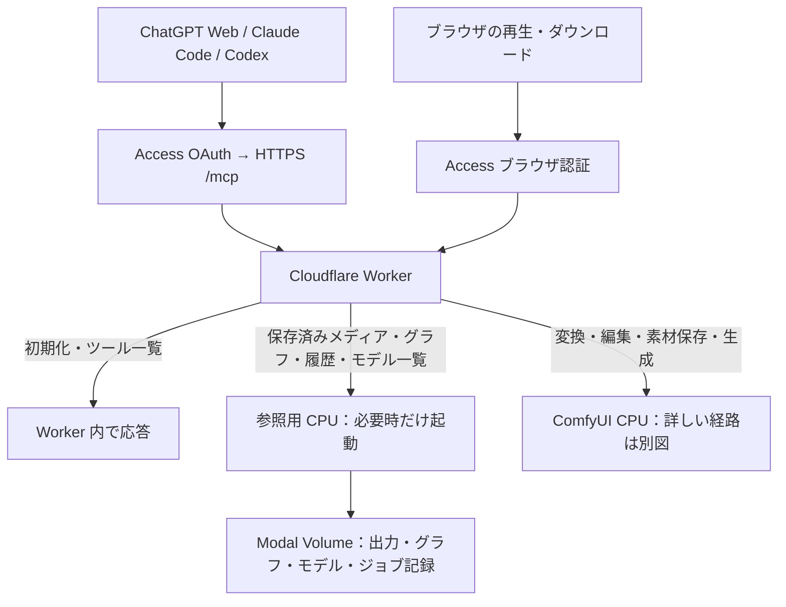

# 保存データの配信と R2 の将来案

このページはVolumeからの読み取り・配信方式とR2の将来案を説明します。MCP全体の起動分岐は[経路図](split-mcp-routing.md)、利用する操作は[ツール一覧](../mcp/tools.md)を参照してください。

## 現在の構成：原本は Modal Volume、取得は参照用 CPU

生成済みメディア・保存済みワークフローの元JSON・履歴・モデルの保存一覧は、ComfyUI を起動せずに参照する。実行用形式への変換やComfyUIのモデル選択肢の確認には、[別の経路](split-mcp-routing.md#ワークフロー取得でcomfyuiを起こす場合)を使う。
Worker が認証したリクエストを、独立した `comfy_split/mediaapp.py` の配信用 CPU に渡す。
ここでいう「アプリ」は Modal のデプロイ単位。利用者が別の画面やログイン先を使うという意味ではない。
既存の HTTPS URL を使い、ファイルも複製せず同じ Volume から読む。
このアプリは Python 標準ライブラリで出力ファイル・保存グラフ・ジョブ記録・モデルのファイル情報を読む。
ComfyUI・PyTorch・Node.js・artokun MCP を起動せず、output・data・models Volume だけを接続する。
モデルの重みはロードせずファイル情報だけを読む。入力・ノード環境の Volume は接続しない。

| 操作 | 起動するもの |
| --- | --- |
| MCP 初期化・ツール一覧・静的プレイヤー HTML | Worker のみ |
| `get_image`・`get_audio`・`get_video`・`read_audio_part`・`read_video_part`・`list_outputs` | 配信用 CPU のみ |
| `list_models` の既定の保存ファイル一覧 | 参照用 CPU のみ。ComfyUI の認識確認ではない |
| `get_workflow(list)`、`get(format:ui)`、保存済み API グラフの `get` | 参照用 CPU のみ |
| `get_history(list/diagnose)`・`get_job_workflow` | 参照用 CPU のみ。保存時点の記録 |
| `list_models(source:runtime)`、UI→API 変換、グラフ解析・検証 | 従来の split CPU。現在のノード定義を使う |
| `/view`・`/api/view` の元の output ファイル（下記の対応形式） | 配信用 CPU のみ |
| GLB・SVGなど配信未対応形式の `/view` | 従来の split CPU |
| 入力・一時画像、`preview` / `channel` 付き変換、ノード・ライブ進捗照会 | 従来の split CPU |
| 生成 | 従来の split CPU と GPU |

配信用 CPU は 0.25 CPU / 512 MiB、最小0台・最大1台。起動待ちは実際のファイル要求で処理し、
`/split/startup` を呼ばない。リクエスト終了後は自動縮退する。30秒は停止待ち設定であり起動・停止時間の保証ではない。
再生中の転送には CPU を使う。読み込み済みデータの再生や、クライアントが停止した後の keep-alive は追加しない。

配信対象はPNG・JPEG・WebP・GIF、MP3・WAV・FLAC・Ogg・Opus・M4A、MP4・MOV・WebM・MKV。
Workerは拡張子で経路を選ぶ。これ以外の出力も従来のComfyUIから開ける。対応形式の配信が失敗した場合にComfyUIへ送り直す仕組みではない。

ファイルは256 KiBずつ送り、全体をメモリに載せない。GET / HEAD、単一 Range（途中・末尾）、
ETag / If-Range に対応する。範囲外は416、削除済みは404、ストレージのI/O障害は再試行可能な503。途中でファイルが置き換わったら配信を中断し、
新旧の内容を混ぜない。保存領域の再読み込みとファイル操作は排他し、遅いクライアントへの送信中はファイルを閉じる。

新規の公開 URL、公開バケット、認証の Bypass は不要。Modal の直接 URL は Proxy Auth が必要。
Worker は固定された配信先にだけ接続し、ユーザーの JWT・Cookie・Authorization は渡さない。
保存先外へのパス、シンボリックリンク、隠しファイル、生成・削除・書き込み操作は受け付けない。
配信失敗時は再試行可能な読取エラーを返し、ComfyUI へ自動迂回しない。

モデルの既定一覧は Volume 内のディレクトリと通常ファイルを読み、サイズ・更新日時を返す。
ComfyUI が追加登録する別名カテゴリや拡張子の制約は推測しない。実際にローダーで選べるかは
`source: "runtime"` で照会する。モデルを追加・削除しても、次の保存ファイル一覧で Volume を再読み込みする。

ワークフローは `data/user/default/workflows` の日本語名・サブフォルダを扱う。
API 形式で保存されていれば直接返す。UI→API 変換は現在のノード定義を必要とするため、
保存ファイルが UI 形式の場合だけ既存 ComfyUI 経路を使う。ノード定義のキャッシュは追加しない。
取得失敗や壊れた JSON を「変換が必要」と見なして ComfyUI を起動しない。

履歴では CPU が保存したジョブ別の記録に GPU の完了記録を重ね、CPU が停止中に完了した結果も取得する。
一覧は小さな索引を順に読み、返す件数分だけ本文を取得する。失敗がCPU側で確定しGPUの完了記録がなくても取得できる。
承認待ち本文や期限切れジョブの履歴を含む台帳全体は読まない。新しい保存形式への移行は[設定手順](../mcp/setup.md#保存済みメディア配信用-cpumediaappの設定)を参照。
`live: false` を付け、実行中の最新状態と区別する。診断は指定 ID、または直近の指定件数内の
失敗を優先する。`get_job_workflow` は投入したグラフだけを返し、認証用 extra_data は返さない。

`prompt_id` で取得する操作は既存ジョブ記録の保持期間（7日）に従う。記録が期限切れでも、
原本が残っていればファイル名によるブラウザ取得や `get_image` は可能。今回、独立した永続ライブラリ索引は追加しない。

## 将来案：R2 に配信用コピーを置く（未実装）

R2 を導入する動機は、繰り返しの再生・ダウンロードで Modal の配信用 CPU も起こさないこと。
モデルの重み・入力素材は引き続き Modal に置き、コピー対象は完成した画像・音声・動画に限定する。
Volume 全体を複製しない。

候補経路は `生成 → Volume commit → 別の CPU が R2 へコピー → Worker が認証して配信`。
コピーを GPU の処理完了条件にせず、生成成功と配信準備中・転送失敗を区別する。
失敗時は転送だけを再試行し、生成し直さない。ファイルサイズ・SHA-256・版を記録し、
アップロードが完了するまで利用可能として公開しない。大きな動画は multipart で送る。

採用前に決めるのは R2 の保持方針。以下は選択肢であり、今回いずれも適用しない。

| 位置付け | 保持・削除 | コピーがない場合 |
| --- | --- | --- |
| 容量を制限した配信用キャッシュ | 原本を Modal に残し、古い R2 コピーだけ整理 | 配信用 CPU から取得・再コピー |
| 独立した成果物ライブラリ | 明示的に削除するまで保持。Modal 原本の削除とは連動させない | 転送状態を表示し、必要なコピーだけ再試行 |

後者では、検索・一覧用の永続索引と、原本・R2コピーそれぞれの削除操作が必要になる。
既存 `/assets` と MCP から利用する場合も、通常の ComfyUI の `/assets/*.js` と衝突させない。
R2 は非公開のまま Worker 経由で配信する。チャット内プレイヤーの認証・CSP・Range は実クライアントで検証する。
短期URLを導入するかは別の判断であり、バケットの公開や Access の解除を前提にしない。

## 費用と採用判断

2026-11-03 時点の公開料金。無料枠は他用途との共用であり、この機能の無料動作を保証しない。

- [Modal](https://modal.com/pricing)：Volume 保存に1 TiB分の無料枠。モデルと成果物の両方で消費する。
  CPU・メモリには実行料金があり、[外向き転送](https://modal.com/docs/guide/network-egress-billing)には別の無料枠がある。
  R2 へ送るデータも外向き転送に該当する。Volume 内の読み書きとは区別する。
- [R2 Standard](https://developers.cloudflare.com/r2/pricing/)：10 GB-month、書込系100万回・読取系1,000万回まで無料。
  保存超過は $0.015/GB-month。外向き転送料は無料だが、書込・読取操作と Worker 利用は別枠。
- [Workers Free](https://developers.cloudflare.com/workers/platform/pricing/)：1日10万リクエスト、1呼出し10msのCPU時間上限。
  認証と MCP の処理も含めて測定する。動画のシークや分割取得でリクエスト数が増える。

まず配信用 CPU の起動時間・実行時間・配信量・再取得頻度を確認する。
コールドスタート待ちや繰り返し取得の負担が問題になった時点で、R2 の保持容量と費用を比較する。
R2 は動画ファイルを保存できるが、自動トランスコードや適応ビットレート配信は別機能。

## 参考にした構成

- [lynclee/comfyui_modal_bridge](https://github.com/lynclee/comfyui_modal_bridge/blob/4f35be2c60538b259c492671eef6bfe7e28fa7ea/SETUP.md#L345-L360)：
  `aigc-r2` はWebサイトへの任意の納品先。短期アップロードURLと、通知失敗後に回収できるファイル情報が参考になる。
  同じ生成処理内で転送を待つ部分や、受渡し後に原本を削除する方針はそのまま採用しない。
- [artokun/comfyui-mcp-relay](https://github.com/artokun/comfyui-mcp-relay)：ローカルの Agent Panel と MCP をつなぐ WebSocket 中継。
  今回の HTTPS MCP・ファイル配信とは役割が異なるため導入しない。
