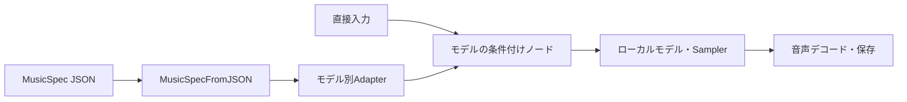
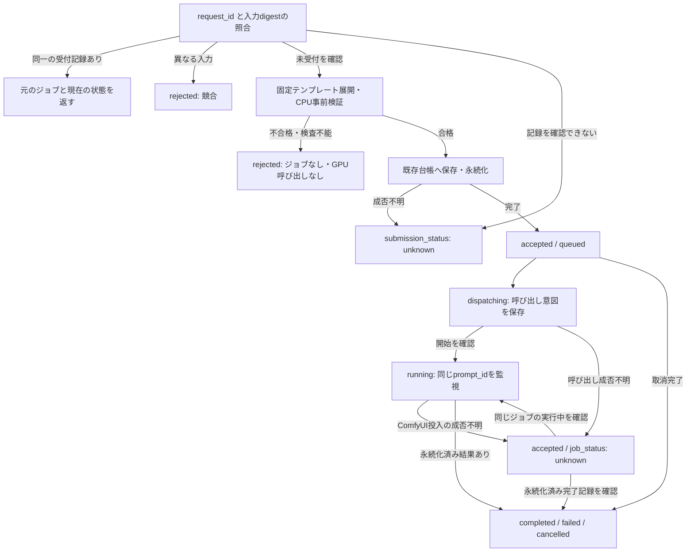

# split 音楽 MCP の入力・受付・障害処理設計

**状態: 設計のみ。`generate_music` は未登録・未実装です。** この文書と JSON は呼び出し契約の提案であり、例を既存 MCP に送っても生成できません。ランタイム、ノード、モデル、認証設定、デプロイは変更しません。

Suno の操作の分け方を参考に、ACE-Step 1.5 XL、YuE2、Stable Audio 3、MiniMax Music M3 を split 内で実行する入口を定義します。Comfy Cloud、Suno、Extras の SGLang サーバーへの自動切り替えはありません。対応していない組み合わせは受付前に拒否します。

- [入力 JSON Schema](schemas/generate-music-input.schema.json): JSON Schema Draft 2020-12。設計資料専用で、MCP の登録処理からは読み込みません。
- [呼び出し例](examples/generate-music.json): 正常形12件と拒否例16件。ファイル名は架空の素材です。
- [応答 JSON Schema](schemas/generate-music-response.schema.json): 受付済み・拒否・受付不明を区別する契約。入力schemaは変更しません。
- [応答例](examples/generate-music-responses.json): 事前検証の拒否、通信切断、同一ジョブの再照合、実行失敗後の再送。ID・ノード番号は説明用です。
- 既存の操作・認証・投入経路: [ツール一覧](../mcp/tools.md)、[MCP 管理](../mcp/setup.md)、[経路図](split-mcp-routing.md)。

## 1. 公開ツールの契約

### `generate_music` の引数

| 項目 | 型・必須性 | 意味 |
| --- | --- | --- |
| `request_id` | 必須 string | 既存投入と同じ `^[a-zA-Z0-9_-]{1,96}$`。再送は同じ ID と引数、新しい生成は新しい ID |
| `model` | 必須 enum | 下表のモデル ID。ファイルパスやプロバイダー指定ではない |
| `operation` | 必須 enum | `create` / `reference` / `cover` / `extend` / `repaint`。省略しない |
| `input` | 必須 object | `mode: direct` または `mode: music_spec` の片方だけ |
| `source_audio` | 操作に応じて必須 string | `upload_media` または `reuse_output` が返す loader 用相対ファイル名。URL、ローカル絶対パス、Suno の曲 ID は受け付けない |
| `seed` | 任意 integer | 0〜9,007,199,254,740,991。JavaScript でも正確に扱える範囲 |
| `extend` | extend のみ必須 object | `continue_at` と `duration_seconds` |
| `repaint` | repaint のみ必須 object | `start_seconds` と `end_seconds` |

未知のキー、別操作の引数、二つの入力経路の混在は schema エラーです。1リクエストはバッチ1の生成です。Sampler、CFG、temperature、任意のノード名・グラフ、接続先 URL、API キーはこのツールの引数にしません。詳細に調整したい場合は従来のワークフロー編集・投入を使います。

`seed` 省略時は `SHA-256(UTF-8("generate_music:" + request_id))` の先頭13桁の16進数を整数として使います。同じ値を生成グラフ内の各乱数入力に設定します。これは再送時の決定性であり、GPUやモデル版をまたぐ波形の完全一致を保証するものではありません。

### 直接入力

`input` は `mode: "direct"`、空白だけではない `style`、明示した `instrumental` が必須です。任意項目は `lyrics`、`title`、`duration_seconds` です。`style` は音楽の指定であり、作詞を依頼する文章としては処理しません。

- `instrumental: false`: 呼び出すAIまたは利用者が用意した、空白だけではない `lyrics` が必須。
- `instrumental: true`: `lyrics` は省略または空文字。歌詞との矛盾を黙って補正しない。
- `title`: 表示・履歴用。ファイル保存パスに直結させない。
- `duration_seconds`: 正の整数秒。create/reference/cover で省略した場合は30秒。extend/repaint では指定禁止。

Suno の Simple モードに相当する、自動作詞を伴う `description` 入力は設けません。呼び出すAIが依頼を `style` と `lyrics` に分けます。直接入力ではモデル用テキストをそのまま渡し、別の LLM による補完・書き換えをしません。

### MusicSpec 入力

`input` は `{"mode":"music_spec","spec":{...}}` です。`spec` は Builder 所有の [MusicSpec 0.1](https://github.com/hndrr/ComfyUI-MusicPromptBuilder/blob/064a6bb4eb1a425bbb4b57cd8b8c34bf6cd4b5ec/schemas/music-spec-0.1.schema.json) を参照します。32項目すべて必須、追加項目は禁止、空文字と整数0は未指定です。型定義はこのリポジトリに複製しません。

生成に必要な条件だけを参照 schema に重ねます。`vocal_mode: vocal` は実際の歌詞を必要とし、`lyrical_theme` だけでは生成を受け付けません。`instrumental` の歌詞は空文字にします。create/reference/cover では `duration_seconds: 0` を30秒に解決し、extend/repaint では0を必須として素材と編集指定から尺を決めます。

MusicSpec 自体の尺の上限は600秒です。直接入力でより長い尺を許すモデルでも、この上限を勝手に緩めません。生成用の解決済み値と元の MusicSpec は別に保持し、未指定値を含む元の仕様を失わないようにします。

`$ref` は上記コミットの raw URL に固定しています。これは公開ソースの識別子で、実環境の接続設定ではありません。実装時は同じ版の schema をビルド時に解決し、生成のたびに GitHub に取りに行きません。Builder 更新時は schema・Adapter・依存版を一緒に照合します。

### モデル ID・尺・操作

以下は**設計で受け付ける組み合わせ**です。ノードの存在や schema 合格だけで実行可能とは判断しません。

| `model` | 操作 | 尺の契約 | MusicSpec 経路の上限 |
| --- | --- | --- | --- |
| `ace-step-1.5-xl-turbo` | create / reference / extend / repaint | 1〜1000秒の目標長 | 新規・参照は600秒、編集は素材から算出 |
| `ace-step-1.5-xl-base` | 同上 | 同上 | 同上 |
| `ace-step-1.5-xl-sft` | 同上 | 同上 | 同上 |
| `yue2-3b` | create / cover | 1〜900秒の上限。プロンプト長でも実効上限が下がり、早く終わる場合がある | 600秒 |
| `stable-audio-3-medium` | create、インストのみ | 1〜285秒の目標長 | 285秒 |
| `stable-audio-3-small-music` | create、インストのみ | 1〜120秒の目標長 | 120秒 |
| `minimax-music-3` | create | 1〜360秒の上限。早く終わる場合がある | 360秒 |

直接入力の整数秒は共通入口の簡素化のための契約です。下位ノードに存在する1秒未満の生成範囲まで公開するものではありません。ACE の1000秒は latent 作成側の上限との共通範囲、YuE2とM3は条件付けノードの上限です。Stable Audio は公式の Small Music 約2分・Medium 約4.75分に対して、この入口の上限を120秒・285秒と定めます。これらは split で全範囲の生成成功を検証した値ではありません。[Stable Audio のモデル資料](https://github.com/Stability-AI/stable-audio-3/blob/main/docs/guides/model-overview.md)

Stable Audio 3 は音声・歌声生成向けではなく、既存Adapterも歌詞を生成入力へ渡しません。この入口ではインストだけを許し、歌詞を渡して無視する動作を禁止します。同モデルの公式SDKには音声変換・inpainting・continuationがありますが、splitでの対応ワークフローは未検証なので、この版の操作一覧には含めません。[公式の推論方法](https://github.com/Stability-AI/stable-audio-3/blob/main/docs/workflows/inference.md)

### 参照・編集の時間指定

| 操作 | 入力と結果 |
| --- | --- |
| create | `source_audio` 禁止。テキストから新規生成 |
| reference | ACEのみ。`source_audio` の音色を参照して新しい曲を生成。元の旋律・歌詞・歌手の同一性を保証しない |
| cover | YuE2のみ。`source_audio` を SheetSage2 で採譜し、melody モードで再生成。声のコピーではない |
| extend | ACEのみ。`0 < continue_at <= 元音源の長さ`。元音源の先頭から `continue_at` までを使い、その後に正の `duration_seconds` 分を生成。結果の目標長は両者の和。元音源の残り部分は新しい結果には含まれない |
| repaint | ACEのみ。`0 <= start_seconds < end_seconds <= 元音源の長さ` の単一区間を再生成。結果の長さは元音源と同じ |

編集時の `input.duration_seconds` は禁止、MusicSpec の同項目は0必須にして、全体尺の二重指定を防ぎます。extend/repaint の全体尺も ACE の1〜1000秒の範囲に収めます。時間は秒で受け付け、ACE の25 latent frames/秒へ変換する際の丸めを実効値として記録します。

保存済み出力を使う場合は `list_outputs` → `reuse_output` → 返却されたファイル名の順です。`list_outputs` の全出力を通した index と `get_audio` の音声だけの index は混ぜません。元ファイルを上書きせず、編集結果は別ジョブに保存します。latent の非編集領域を維持する設計であり、VAE再エンコードや音声保存後の波形の完全一致は保証しません。

## 2. Suno との対応

参照は [Suno MCP の取得済み schema](https://github.com/hndrr/suno-mcp-rest-bridge/blob/802678ddca31773f91f5c388b68c4f0e4a069c85/test/fixtures/suno-input-schemas.json)（取得日時 2026-11-05）と同版のブリッジです。Suno の制限をモデル共通の制限とは扱いません。

| Suno 側 | split の設計 |
| --- | --- |
| `audio-create` の `style` / `lyrics` / `instrumental` / `title` | 直接入力へ採用。MusicSpec は別の排他的な入力経路 |
| Simple モードの `description` | 自動作詞を含めないため非採用。呼び出すAIが入力を準備 |
| `duration` / `duration_guidance` / `duration_strict` | `duration_seconds` とモデル別の意味。厳密な終曲を装うフラグは作らない |
| `idempotency_key` | split既存の `request_id` を維持 |
| `reference_audio_ids` / cover の `id` | splitの `source_audio`。この版では1素材。参照とカバーを区別 |
| `audio-extensions-create` の `continue_at` | 延長の開始位置として採用し、追加する長さを別指定 |
| `audio-wait` / `audio-retrieve` / download | 既存の `get_job_progress` / `list_outputs` / `get_audio` を使用 |
| `controls.variety` / `weirdness` / `audio_influence` / `style_influence` / `max_mode` | 対応する意味が確認できないため非採用。CFG・temperature・denoiseへの変換をしない |
| `voice_id` / `workspace_id` / mashup / full-song | 非採用。声の識別子や曲の結合管理は追加しない |
| 曲数 | splitでは1件。Suno側の複数clip返却仕様を移植しない |

Suno由来の文字数制限は設定しません。上限なしの入力を無制限に処理する意味ではなく、既存のリクエストサイズ制限と選択したモデルのコンテキスト制約を適用し、切り捨てずにエラーを返します。

## 3. ノードの接続と依存

### 直接入力と Builder 経由

MusicSpec経路は `MusicSpecFromJSON` と Adapter を実際の保存グラフに残します。受付で文字列だけに潰して削除しません。元の MusicSpec、モデル、入力音源、seed、実効パラメータ、使用したテンプレート・Adapter版が後から確認できるようにします。形式変換の所有元は [MusicPromptBuilder 0.3.0](https://github.com/hndrr/ComfyUI-MusicPromptBuilder/tree/064a6bb4eb1a425bbb4b57cd8b8c34bf6cd4b5ec) です。

| モデル | 直接入力 | MusicSpec 経路と必要な調整 |
| --- | --- | --- |
| M3 | `style` → `MiniMaxMusic3TextEncode.caption`、`lyrics` → 同 `.lyrics` | `MiniMaxMusic3Adapter` の caption/lyrics/warningsを使用。既存のタグ正規化を複製しない |
| ACE | `style` → `TextEncodeAceStepAudio1.5.tags`、歌詞 → 同 `.lyrics` | `ACEStepAdapter` の caption/lyrics/bpm/keyscale/timesignature/vocal_language。下記の接続差をBuilder側で解消 |
| YuE2 | `style` / `lyrics` → `YuE2GenerateMusic` | Builder側に `YuE2Adapter` を追加する設計。出力はstyle/lyrics。採譜・ABC処理は生成グラフの役割 |
| Stable Audio | `style` → `CLIPTextEncode` → `ConditioningStableAudio` | `StableAudio3Adapter.prompt` を同じ条件付けへ接続。任意のQwenリプロンプト経路は使わない |

インストの直接入力は、ACEでは歌詞入力を `[Instrumental]`、M3では `[instrumental]`、YuE2では空文字とし、style/captionにはインスト指定を明示します。これはモデル固有の入力変換で、作詞ではありません。MusicSpec経路のM3は既存Adapterのインスト用セクションタグを使います。各経路のボーカル抑制は実生成の受け入れ確認対象です。

M3とYuE2は条件付けノードが返した実際の `seconds` を各 `Empty...LatentAudio` に接続します。入力の上限秒数でlatentを固定しません。ACEは条件付けとlatentの尺を揃え、編集時は編集ノードが返す実効尺を使います。出力は `SaveAudioAdvanced` の MP3/V0、バッチ1を初期契約とします。

### Builder 側の必要変更

以下は後続実装の作業であり、この設計変更では各リポジトリを編集しません。

- YuE2用 `YuE2Adapter` を追加し、MusicSpecからstyleとlyricsを決定的に作る。別LLMは呼ばない。
- ACEの `meter` は `2/4 → 2`、`3/4 → 3`、`4/4 → 4`、`6/8 → 6`、既に `2/3/4/6` ならそのまま。空欄は4。それ以外はエラーとし、例えば `7/8` を4拍子へ変換しない。
- ACEの `bpm: 0` は120、空のkey/scaleは `C major`、空のlanguageは `unknown` に解決する。指定したBPMは10〜300、調性は実ノードの選択肢、言語は単一の対応コードに限定する。自由文・混合言語指定は黙って別の言語に変換しない。keyかscaleだけの指定はエラーとして完全な指定を求める。
- ACEのインスト指定をcaptionと歌詞markerへ反映する。現在のAdapterは `vocal_mode` を十分に反映しないため、そのまま接続して完了とはしない。
- 直接入力のACEもBPM120、C major、4拍子、言語unknownを使う。`style` から数値や言語を推測抽出しない。これらを厳密に指定する場合はMusicSpec経路を使い、受付結果に実効値を示す。
- M3は既存の歌詞正規化・警告を再利用し、歌詞本文を自動で書き換えない。他Adapterについても利用しない非空項目があれば、変換の所有元で警告を作り、黙って消失させない。titleなど履歴用に保持する項目は警告対象にしない。

標準の生成設定は既存の成功グラフを基にモデルごとに固定し、公開入力へSamplerの全項目を持ち込まない。Base/SFTとTurboの設定を同一とは仮定せず、新しいモデル・操作のテンプレートは初回実装時に生成検証する。導入後のノード更新は、現在の環境で第4節の事前検査が通れば利用できる。過去に検証したノード版との一致や、更新のたびの実生成検証は利用条件にしない。

### 参照・カバー・編集

| 経路 | 接続案 | 検証上の注意 |
| --- | --- | --- |
| ACE reference | `LoadAudio → VAEEncodeAudio → ReferenceTimbreAudio` をpositive条件へ接続 | `generate_audio_codes: false`。negativeは参照を付ける前の条件から作り、参照payloadをnegativeへ混入させない |
| YuE2 cover | `LoadAudio + AudioEncoderLoader → SheetSage2AudioToABC(mode: melody) → YuE2GenerateMusic(abc, mode: melody)` | SheetSage2のモデルが必要。ABC出力はlistなので1曲に収まることを確認し、複数要素の場合は曖昧なまま複数曲を生成しない |
| ACE extend | 必要なら `TrimAudioDuration` で先頭からcontinue_atまで → `ACEStep15XLExtendAudio(left: 0, right: 追加秒数)` → KSampler | 返却されたlatentとsecondsを使用。前方への延長や複数区間の同時編集は公開しない |
| ACE repaint | `LoadAudio → ACEStep15XLRepaintAudio(start, end, mask_value: 1)` → KSampler | 元と同じ全体尺、単一区間。境界の自然さと非編集部分への影響を確認 |

extend/repaintは [starsFriday/ComfyUI-ACEStep](https://github.com/starsFriday/ComfyUI-ACEStep/tree/1f0c0841e0e609732c41c33d164f766363d2736a) の上記2ノードを接続先とする案です。ソース上はACE 1.5 XLのlatentを延長・マスクする実装を確認していますが、splitでの適合性・生成品質は未検証です。既存コードの動作が検証を満たさなければ、その操作は利用不可のままにし、同名の別ノードへ自動置換しません。

### Extras の扱い

[Extras](https://github.com/hndrr/ComfyUI-MusicPromptBuilderExtras/tree/8a1c7141697dceab4de24890c42cdd0627e9e0b6) は標準経路の依存にしません。

- `MusicSpecLLMRequest` と `MusicDirectorMusicSpecRequest` は依頼文・出力schemaの構築であり、単独でLLMを実行しない。AgentRuntimeを使う別案として整理し、今回のツールでは自動実行しない。
- `MusicPromptLLMRewriterPrompt` は任意LLMへのbrief生成。呼び出すAIが歌詞・方向性を用意する今回の標準経路には挿入しない。
- `MiniMaxMusic3LyricsValidator` は単独検査には使えるが、BuilderのM3 Adapter後に同じ正規化を重ねない。
- `MiniMaxMusic3SGLangGenerate` は別サーバーへの通信を伴う。ComfyUIネイティブM3とは別の実行経路として扱い、今回のmodel IDで選択させない。
- 併用する場合はBuilder 0.3.0以降を使う。0.2.xはExtrasとノードIDが重複するため不可。

## 4. 事前検証、受付、再送、障害処理

以下は後続実装の契約です。現在のランタイムがすべて実装済みであることを示しません。防げる不整合はGPU起動前に拒否しますが、重みの破損・VRAM不足・GPU固有処理・生成中の動的出力などの実行時エラーは残ります。

### 受付の処理順

1. 既存の認証済みMCP入口で入力JSON Schemaを一度検証し、型を確定する。認証方式・公開経路は増やさない。
2. 既存の受付ロック内で、元の音楽引数から `music_input_digest` を計算し、既存台帳と退避記録の `request_id` を照合する。受付済みなら同じ入力は元のジョブを返し、異なる入力は競合として拒否する。**この照合をテンプレート展開・Adapter評価・現在の環境検査より先に行う。** 台帳を読めず受付の有無を判定できなければ受付不明とする。
3. 未受付の場合だけ、現在のsplit環境でモデル・操作・入力経路に対応する固定テンプレートを選び、値・seedを埋める。呼び出しごとにAIがノードの接続を考えたり、自動修復したりしない。元グラフを加工する既存の準備処理もこの段階で完了する。
4. 下表の検査とBuilderのCPU事前評価を行い、同じ環境のComfyUI本体で最終グラフを検証する。いずれかが不合格、または検査を完了できなければ、ジョブを作らずGPUも呼び出さない。
5. 合格したグラフ・環境・素材を既存の受付経路へ渡す。台帳に元引数のdigest、確定グラフ、seed、テンプレートID・リビジョン、Builder/Adapterの実装情報、応答用の実効値・警告を保存し、既存の永続化を完了してから `accepted` を返す。検査後に別グラフを組み直さない。
6. 既存dispatcherが一度だけGPUを呼び出す。GPU側の投入と、その後の監視を分離する。MCP応答の配送成否は生成の開始・取消条件にしない。

digestには既存の `body_digest` と同じJSONのキー順整列・UTF-8・SHA-256を用い、対象を `generate_music` の元引数全体とします。空白や歌詞を正規化せず、デフォルト補完前の値を使います。JSONオブジェクトのキー順だけの違いは同一ですが、seed省略と明示、空文字と省略などは別入力です。既存のグラフdigestを音楽入力digestで置き換えず、同じ台帳に区別して保存します。他の投入ツールで使ったIDを音楽依頼として流用することも競合です。

受付ロックと既存の環境固定を使い、CPU検査とGPU投入が同じノード実装・グラフ・ローダーのモデル・入力素材を参照するようにします。素材の確認・保持は既存の素材保護処理を使い、検査から投入の間に同名ファイルへすり替わる状態を受け付けません。環境更新やモード切替中に一致を確保できなければ新規受付を止めます。受付済みグラフの環境は保持し、更新後の環境へ暗黙に移しません。

### GPU起動前に確認する内容

| 対象 | 確認と拒否条件 |
| --- | --- |
| テンプレート | 明示されたモデル×操作×入力経路のテンプレートがあること。音声保存ノードIDをテンプレートに含める。別モデル・操作への代替はしない |
| ノード・許可 | 現在のCPU環境で必要なclassが読み込め、実装元が許可対象と一致し、使用するノードと入出力経路が既存MCPポリシーを通ること。同名ノードの別実装への置換は許可とみなさない |
| モデル | ファイルの存在だけでなく、使用するローダーの現在の選択肢で認識されること。重み内容やGPUロードの成功までCPU検査で保証しない |
| 入力素材・編集範囲 | 対象が読み取り可能な音声で、実測した長さ・編集範囲・編集後の全体尺が第1節に適合すること |
| Builder変換 | 同じBuilder実装でMusicSpec解析と対象Adapterの文字列・数値変換をCPU評価する。ACEの未指定値解決、言語・拍子・enum・数値範囲、M3の歌詞正規化・警告を第3節どおりに評価する |
| グラフ | ComfyUI本体の検証でリンク型・必須入力・値制約を満たし、予定したすべての音声保存ノードまで成立すること |

BuilderのCPU評価は対象の純粋な解析・変換処理だけを呼び出し、任意の生成ノード、LLM、SGLang、採譜をCPUで実行しません。変換結果は実際の接続先の入力定義・enum・範囲と照合します。リンクの型が `STRING` であっても、例えば言語コードが接続先の選択肢にない場合は拒否します。接続先に独自の値検証がある場合はその実装を使い、別のenum表や独自のグラフ検証エンジンを作りません。CPUで変換・検証できない状態では検査を省略せず停止します。

確定グラフには `MusicSpecFromJSON → Adapter` を残し、このグラフ自体を検証・保存・投入します。事前評価は値を確かめるためのもので、生成グラフからBuilderを除去する処理ではありません。同じ入力・実装で変換が決定的であることを後続実装で確認します。SheetSage2の採譜結果の件数など、GPU実行後に初めて分かる動的な値は実行時の検査として残ります。

CPU側に既存の内部アクセス制御下の非公開検証経路を設け、同じ環境の `execution.validate_prompt` を呼びます。CPUの `/prompt` へ投入せず、`PromptQueue.put` の生成禁止ガードも解除しません。これは本体の検証を呼び出す薄い経路で、公開MCPツールや別認証ではありません。

検査時は全出力を対象にし、部分実行リストで不正な出力を除外しません。本体の戻り値に対して、次のすべてを要求します。

- 検証成功フラグが `true` で、トップレベルの検証エラーがない。
- `node_errors` が空。
- テンプレートが予定する音声保存ノードが一つ以上あり、その全IDが検証済み出力リストに含まれる。

ComfyUI本体は一部出力だけ有効でも成功を返し得るため、成功フラグだけでは受付できません。エラーは対象ノード・入力・理由を応答へ写し、検証情報が不足する場合も合格にしません。ノード更新後もこの検査に通れば受け付け、不整合があれば新規受付前に止めます。参照コミットとの完全一致を求める検査は追加しません。

### 受付記録と再送

元の音楽入力と確定グラフは既存のジョブ保存に含めます。CPU再起動時は永続記録から復元し、履歴退避時も `request_id`、音楽入力digest、元の `prompt_id`・番号・状態、受付応答の不変項目を既存の退避記録へ残します。既存の開始・完了記録と突き合わせ、記録が読めない場合を「未受付」と扱いません。退避後の詳細グラフ・音声の保持期間は既存の方針に従い、消えた成果物を再生成して補いません。

`accepted` は受付永続化の完了を確認した場合だけ返します。保存・通信の失敗で永続化の成否が不明なら `unknown` とし、「受付されなかった」と断定しません。既存記録への照合も同じ規則に従い、メモリ上の未確定状態だけで受付済みとは返しません。dispatcherへの引き渡しにも既存の永続化完了を必要とし、未確定のメモリ上の受付をそのまま実行しません。永続化後の応答配送だけが失敗した場合は元のジョブを続行します。新しい台帳、ジョブ状態、待機ツールは作りません。

### 投入と監視の状態遷移

図の受付状態は応答上の分類であり、台帳へ新しい状態を追加するものではありません。ジョブの `unknown` は生成を再投入する待ち行列ではありません。既存の開始・完了記録で同じ実行を追跡し、完了記録が見つかればその結果へ進みます。実行を特定できなければ `unknown` を維持します。

GPU内の `POST /prompt` は同じ `prompt_id` で一度だけ行い、HTTPの自動再送も禁止します。応答を失ったらそのIDのキューと履歴を読み、追跡できれば監視を続け、確認できなければジョブを `unknown` とします。キュー・履歴に一時的に見当たらないだけでは未投入の証明になりません。GPU呼び出し前後の曖昧さも既存のdispatch記録・開始記録で扱い、自動で再spawnしません。

MCP接続や進捗WebSocketの切断は生成取消の理由にしません。WebSocketの接続・再接続に失敗しても、同じIDの履歴で結果を確認します。状態読み取りの一時的な通信失敗には、失敗後の待ち時間を1秒、2秒、5秒、以後5秒として再試行します。読み取りが成功したら待ち時間をリセットします。これはキュー・履歴などの読み取りに限り、生成POSTの再送には使いません。

再試行と個々の読み取りは既存の生成タイムアウトの残り時間内に収め、通信復旧や再送で締切を延長しません。認証・入力不正などの恒久的な拒否を一時通信障害として繰り返しません。実行開始を確認できているジョブの生成タイムアウトは実行失敗ですが、投入・完了の成否そのものが不明な場合は、読み取りの期限切れだけで失敗や未投入と断定しません。

ノード例外・OOM・プロセス終了・生成タイムアウトは、確認できた実行失敗として既存のエラー情報に理由を残します。出力取得や完了記録の読み取り失敗は実行失敗と区別し、同じジョブを再照合します。`completed` を返すには、既存の出力保存と完了記録の永続化が済んでいることが必要です。別モデルへの切り替え、グラフの自動修正、生成の自動再試行はしません。

### 障害・再送時の復旧表

| 状況 | 返却・保持する状態 | 次の処理 |
| --- | --- | --- |
| ノード欠落、接続・Adapter値不正、保存経路不成立 | `rejected / preflight_failed` | 対象ノード・入力・理由を返す。ジョブ・GPU呼び出しを作らない |
| 未受付を確認後、環境照会・CPU検査を完了できない | `rejected / preflight_unavailable` | 新規受付しない。検査復旧後に再依頼可能 |
| 同じID・同じ入力 | `accepted` と元ジョブの現在状態 | グラフを再構築せず元のID・seedを返す |
| 同じID・異なる入力 | `rejected / idempotency_conflict` | 今回の引数を拒否。元のジョブを変更・取消しない |
| 受付応答が失われた、受付保存や台帳読み取りの成否不明 | `submission_status: unknown` | 同じID・同じ入力で再照合。未受付と決めつけず、新IDを自動発行しない |
| CPU再起動・履歴退避後の同一依頼 | 永続記録・退避記録の元ジョブ | 再生成しない。成果物の保存期限切れも再生成の理由にしない |
| GPU呼び出し、またはComfyUI投入の成否不明 | `accepted / job_status: unknown` | 開始・完了記録、同じIDのキュー・履歴を確認。自動再投入しない |
| MCP切断・進捗WebSocket断 | 元ジョブを継続 | 同じIDの進捗・履歴を確認。切断だけでは取消しない |
| 履歴・状態読み取りの一時障害 | 最後に確認した状態を維持 | 上記の間隔と既存締切で読み取りだけ再試行。未取得を失敗・完了と誤報しない |
| ノード例外・OOM・プロセス終了・生成タイムアウトを確認 | `failed` | 既存のエラー詳細を返す。自動修正・モデル変更・再生成なし |
| 出力・完了記録を取得できない | 確認済み状態を維持。成否不明は既存の `unknown` | 永続化済み結果を確認する。読み取り失敗を生成失敗と断定しない |
| 完了・失敗・取消済みへの同一依頼 | `accepted` と元の `completed / failed / cancelled` | 元の終端状態を返す。再生成は失敗内容を確認後、新しいIDの別依頼として行う |

### `generate_music` の応答契約

| フィールド | 契約 |
| --- | --- |
| `request_id` | 常に元のIDを返す |
| `submission_status` | `accepted / rejected / unknown`。今回の受付を確認できたかを示す |
| `prompt_id` | `accepted` で必須。永続化済みの元のID。拒否・受付不明では返さず、仮IDを作らない |
| `job_status` | `accepted` で必須。既存の `queued / dispatching / running / unknown / completed / failed / cancelled` |
| `number`, `model`, `operation`, `seed`, `effective_parameters`, `warnings` | `accepted` で必須。初回受付の確定値を保持し再送でも返す。状態以外を現在の環境で計算し直さない |
| `error` | `rejected / unknown` で必須。`code` と `message`。検証不整合は `issues` にノードID・class・入力名・理由コード・説明を付ける |

受付エラーのコードは `invalid_request`、`preflight_failed`、`preflight_unavailable`、`idempotency_conflict`、`submission_unknown` に限定します。`preflight_failed` では `issues` を必須とし、ノード欠落など特定の入力名がない場合だけ `input: null` を使います。内部トレース、秘密情報、環境識別子を応答へ転記しません。

`effective_parameters` は `duration_seconds` と `duration_semantics: target_length | upper_bound`、ACEならBPM・keyscale・timesignature・languageを含みます。編集時の `duration_seconds` は追加秒数でなく編集後の全体尺です。M3/YuE2は `upper_bound` とし、指定秒での終曲を保証しません。`warnings` は初回受付で確定した文字列配列です。Adapter実行時の追加警告と実行エラーは既存の履歴に残し、この受付応答の `error` と混在させません。`accepted / failed` の実行理由は `get_job_progress`・`get_history` で取得します。

`submission_status: unknown` は受付の永続化を確認できない応答です。`submission_status: accepted, job_status: unknown` は受付記録とIDが確定しており、実行状況が不明な応答です。通信が完全に切れた場合はJSON自体を届けられないため、応答可能なMCP側が前者へ変換し、クライアント自身の通信タイムアウトも同じ再照合手順で扱います。HTTP切断をサーバーの明示的拒否と解釈しません。

このschemaは有効な `request_id` が得られた呼び出しの業務応答を対象とします。ID欠落・不正やJSON解析不能・認証失敗は既存MCPの入力・プロトコルエラーに従い、補完IDを発行しません。`rejected` は今回の引数で新規受付していないことを示し、同じIDの元ジョブの不存在を保証するものではありません。

進捗は `get_job_progress`、保存済み履歴は `get_history`、中止は `cancel_job`、出力一覧は `list_outputs`、音声は `get_audio`、実際のグラフは `get_job_workflow` を使います。受付応答に音声URLや架空の完了情報は作らず、新しい待機ツールは追加しません。

### 既存実装との差分と担当箇所

| 既存箇所 | 再利用する仕組み／後続実装で必要な変更 |
| --- | --- |
| [台帳](../../comfy_split/state.py) | ID照合、保存、退避、再起動時の `unknown` を再利用。音楽入力digestと確定した応答情報を保存・退避の対象にも追加する |
| [MCP受付](../../comfy_split/mcp_approvals.py)・[Gateway](../../comfy_split/gateway.py) | 既存ロック、許可、永続化後のreceipt、dispatch記録を再利用。音楽入力の照合を展開より前に置き、CPU事前検証を受付前に接続する |
| [CPU Bridge](../../extensions/ComfyUI-Modal-Bridge/__init__.py)・[生成禁止ガード](../../extensions/ComfyUI-Modal-Bridge/cpu_guard.py) | ガードを維持した非公開の本体検証呼び出しを追加する |
| [GPU Worker](../../comfy_split/worker.py) | 同一IDでの一度の投入、開始・完了記録、履歴を使う監視を再利用。現状の読み取り例外が広い例外処理で `failed` になる経路を分け、読み取りの再試行と投入成否不明の照合を追加する |
| [MCP中継](../../worker/src/remote-mcp.ts) | 既存認証と同一ID再送方針を再利用。音楽の受付状態を構造化し、通信失敗を拒否と誤報しない |

ここに挙げた変更は今回の成果物に含めません。CPUでの本体検証の接続、音楽用の永続化項目、読み取り再試行はいずれも後続実装です。

### 2026-11-06時点の根拠と公開条件

これは設計の根拠であり、特定環境の導入・設定変更履歴ではありません。モデルファイルがあることと、ローダーに認識されること、MCPで許可されること、生成成功は別々に確認します。

| 経路 | ノード確認 | 追加依存・変更 | 生成検証 |
| --- | --- | --- | --- |
| ACE新規生成 | coreの条件付け・latent・保存ノードを確認 | MusicSpec経路ではBuilderとACE Adapter調整 | Turboの既存グラフに実測資料あり。今回の入口、Base/SFTは要検証 |
| ACE参照 | coreの `ReferenceTimbreAudio` を確認 | MusicSpec経路は同上 | 要検証 |
| YuE2新規生成 | coreの生成・latentノードを確認 | MusicSpec経路はYuE2 Adapter新設 | 既存グラフに実測資料あり。今回の入口は要検証 |
| YuE2カバー | coreのSheetSage2・YuE2接続仕様を確認 | SheetSage2モデル、MusicSpecなら新Adapter | 採譜・1出力への接続・カバー品質を要検証 |
| Stable Audio 3新規 | coreノードと公式テンプレートを確認 | MusicSpecならBuilder | Mediumの既存グラフに実測資料あり。Small Musicと今回の入口は要検証 |
| M3新規 | coreのcaption/lyrics入力・上限・seconds出力を確認 | MusicSpecならBuilder | 今回の入口・歌もの・インストとも要検証 |
| ACE延長・区間再生成 | 追加パックのソース上で確認 | XL用Extend/Repaintノードの導入・許可が必要 | 未検証。有効化しない |

既存の実測資料は [GPU選択と音楽生成の計測](../guides/split-gpu.md) を参照します。上表のどの行も、この変更によって新しいMCP機能として利用可能になるわけではありません。

将来は許可ポリシーに、使用するcoreのACE・YuE2・AudioEncoderと、BuilderのJSON変換・対象Adapter、追加パックの該当ノードだけを実装元とともに登録します。現行の許可リストにないノードは、インストール済みでも実行できません。パック全体、特にExtras全体の一括許可や認証の迂回はしません。

## 5. 検証と後続実装の受け入れ条件

### この設計変更で確認すること

呼び出し例の `valid` はJSON Schemaに合格する入力形です。実際のMCP利用可能性を表しません。`invalid.rejected_by: schema` はschemaで拒否し、`semantic` はschemaには合格したうえで下記の意味検証により拒否します。JSON Schemaだけで兄弟値の大小や音源の実時間は比較できません。

| 検証場所 | 拒否する例 |
| --- | --- |
| JSON Schema | 直接入力とMusicSpecの混在、インストと歌詞の矛盾、歌詞欠落、MusicSpec項目欠落、未知フィールド、非対応モデル×操作、モデル上限超過、編集時の二重の尺指定、URL素材 |
| 意味検証 | 区間の逆転、音源を越える区間、存在しない・音声ではない素材、全体尺の上限超過、ACEに接続できない言語・拍子・調性・BPM |
| 実行可否 | 必須ノード・モデル・Adapterの欠落、MCPポリシー未許可、テンプレートの初回導入検証未完了、現在の環境での事前検査不合格。導入後のノード更新ごとの実生成検証は要求しない |

検証時は固定版のMusicSpecを取得してJSON Schema validatorの参照レジストリへ登録し、ローカルのschemaと例を照合します。新しいテスト基盤、プロジェクト依存、CIジョブは追加しません。schemaと実ノードの上限・名称の照合はこの資料の参照版を使い、モデルをダウンロードしたりGPUを起動したりしません。

この版は `jsonschema 4.25.1` で照合済みです。正常形12件は合格し、schema拒否例11件は拒否、意味検証の拒否例5件はschemaを通ることと記載した違反条件を確認しました。両入力経路のモデル別尺上限、seedの整数上限、省略時の入力形、MusicSpecの必須32項目、資料内の相対リンクも確認しています。意味検証の実装や実生成が完了したことを示すものではありません。

今回追加した応答schemaも `jsonschema 4.25.1` で静的照合しました。応答例の `valid` 19件は合格し、`invalid` 12件は拒否されます。`valid` は応答契約上の正常形であり、`rejected` や `unknown` の応答も含みます。`invalid` は必須ID・理由の欠落、二種類のunknownの混同、未定義のジョブ状態など、返してはいけない形です。3種類の受付状態と既存7種類のジョブ状態、同一ID再送時の不変項目、既存M3入力例との対応、相対リンクを確認しました。入力schema・既存入力例・ランタイムは変更していません。障害注入と実生成は行っていません。

### 実装段階で行う確認

事前検証・障害処理の受け入れ条件は以下に絞ります。既存テストを拡張し、別の台帳・テスト基盤は追加しません。この表は未実施の実装受け入れ条件です。

| 確認項目 | 合格条件 | 優先する既存テスト |
| --- | --- | --- |
| GPU前の不整合検出 | ノード欠落、リンク型不一致、Adapterの不正値、保存出力の欠落・部分検証成功を拒否し、ジョブ作成・GPU呼び出しが0回 | [Gateway](../../tests/split/test_gateway.py) と既存MCP許可・素材テスト |
| ノード更新 | 互換更新は事前検査で合格し、不整合更新は受付前に停止する。過去の版や更新ごとの実生成を合格条件にしない | 同上 |
| 受付応答断・再送・再起動・退避 | 同じID・入力で元のジョブを返し、ジョブ数・GPU呼び出し回数が増えない。入力違いは競合。保存成否不明を拒否と誤報しない | [台帳](../../tests/split/test_state.py)、Gateway、[MCP中継](../../worker/tests/remote-mcp.test.mjs) |
| 監視通信の一時障害 | 進捗接続・履歴取得が一時的に失敗しても生成を取消さず、同じジョブの永続化済み結果を取得できる。再試行間隔と既存締切を守る | [GPU Worker](../../tests/split/test_worker.py)、Gateway |
| 投入成否不明・完了記録の読み取り障害 | POST応答喪失時は同じIDを照合し、追跡不能は `unknown`。POST・GPU呼び出しを増やさず、実行失敗と区別する。結果の読み取り失敗だけで `failed / completed` にしない | GPU Worker、Gateway |
| 終端状態への再送 | 実行失敗・完了・取消後の同じIDは元の状態を返し、再生成しない | 台帳、MCP中継 |

音楽入力・各モデルの初回実装については、既存の条件を維持します。

- 変更対象の既存MCP・許可ポリシー・素材テストを優先し、Workerのコード変更時は `npm run typecheck` も行う。重複したschema検証や全件テストは増やさない。
- 両入力経路について歌もの・インストを確認し、元のMusicSpecとAdapterが保存グラフに残ること、警告・実効値・再送識別子が保持されることを確認する。
- 失敗時にクラウド・別モデルへ切り替わらないことを確認する。
- ACE参照、YuE2採譜カバー、ACE延長・区間再生成を個別に検証する。元音源を変更しないこと、音声が有限値で無音でないこと、尺の丸め、編集境界、非編集部分への影響を確認する。
- M3/YuE2の早期終曲をエラーと誤認せず、要求上限と実際の長さを区別する。Stable Audioでは歌詞を受け付けないことを確認する。
- 通常の認証・許可・投入経路を通ることを確認する。認証・中継を変更した場合は、Modal接続と未認証アクセスの拒否も既存手順に沿って確認する。

### 参照版

SunoとBuilderのschemaの参照先は上記コミットに固定しています。ComfyUIの説明は実ノード照会と [coreソース](https://github.com/Comfy-Org/ComfyUI/tree/63e5bf594339f676b4b15e072529873e3448409e/comfy_extras)（`nodes_ace.py`、`nodes_yue2.py`、`nodes_audio_encoder.py`、`nodes_minimax_music.py`、`nodes_audio.py`）を照合したものです。部分出力が有効でも成功を返す挙動は、同版の [`execution.validate_prompt`](https://github.com/Comfy-Org/ComfyUI/blob/63e5bf594339f676b4b15e072529873e3448409e/execution.py) を参照しています。これらは設計の根拠を再現するための参照版で、現在のデプロイ版との一致を意味しません。実行時は検査・投入する一つのジョブ内で環境を固定しますが、更新後のノードがこの参照版と異なることだけを理由に拒否しません。
